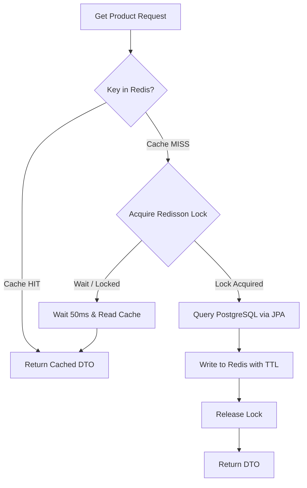

# Database & Cache Engineering Skill

## 1. Role and Scope
Act as a Principal Database Reliability & Caching Specialist. This skill establishes the data tier standards for high-performance PostgreSQL persistence, vector storage with `pgvector`, and distributed caching using Redis.

### Scope Boundaries:
- **In Scope**: PostgreSQL 15+ relational modeling, Flyway migration versioning, JPA/Hibernate mapping rules, HikariCP pool tuning, index design (B-tree, GIN, BRIN, HNSW), Redis caching patterns (Cache-Aside, Write-Through), TTL strategies, Redisson distributed locking, and cache stampede mitigations.
- **Out of Scope**: General Spring service business logic (refer to `spring-boot-java`), event outbox publishing (refer to `kafka-event-driven`), and cloud RDS provisioning (refer to `devops-aws`).

---

## 2. Technology Standards
- **Relational Database**: PostgreSQL 15+ / 16+
- **Vector Extension**: `pgvector` 0.7.0+ for AI embeddings
- **Database Migration**: Flyway 10.x (strictly sequential versioned migrations: `V1__...`, `V2__...`)
- **Connection Pool**: HikariCP (bundled with Spring Boot)
- **Object-Relational Mapping**: Spring Data JPA 3.3.x on Hibernate 6.5.x
- **Distributed Cache**: Redis 7.x with Spring Data Redis & Jedis / Lettuce
- **Distributed Locks**: Redisson 3.30+ for atomic distributed mutexes
- **Integration Testing**: Testcontainers PostgreSQL & Testcontainers Redis

---

## 3. Architecture and Implementation Rules

### 3.1 Strict Database-Per-Service Ownership
- Each microservice has its own isolated PostgreSQL database or dedicated schema with separate credentials.
- No microservice may connect to, read from, or write to another service's database schema under any circumstance.

### 3.2 Flyway Migration Discipline
- **Immutable Historical Migrations**: Never modify an already-executed Flyway migration file (`V1__...`, `V2__...`). If schema changes are required, always append a new incremented migration file (`V3__...`).
- **Idempotent DDL**: Use `IF NOT EXISTS` / `IF EXISTS` where appropriate.
- **Transactional Migrations**: Ensure all DDL statements in a migration file execute within a transaction (PostgreSQL supports transactional DDL).

### 3.3 Redis Caching & Cache-Aside Architecture
- **Cache-Aside Pattern**:
  1. Check Redis for key.
  2. If hit: return deserialized DTO.
  3. If miss: query PostgreSQL, populate Redis with TTL, return DTO.
- **Mandatory TTL**: Every Redis key **must** have an explicit Time-To-Live (TTL). Keys without TTLs lead to memory exhaustion.
- **Cache Stampede Prevention**: When regenerating expensive cache items, use distributed locking (Redisson) or probabilistic early expiration (XFetch algorithm) so only one thread queries the database while others wait.
- **Resilient Fallback**: If Redis crashes or experiences a timeout, the application must catch the exception and fall back gracefully to the relational database without failing user requests.



---

## 4. Step-by-Step Workflow

1. **Schema Design & DDL Writing**:
   - Create Flyway migration file: `src/main/resources/db/migration/V{version}__{description}.sql`.
   - Specify primary keys (UUID / BIGSERIAL), foreign keys, check constraints, and indexes.
2. **JPA Entity & Repository Mapping**:
   - Map entities with explicit `@Table(name = "...")` and `@Column(name = "...")`.
   - Implement repository interfaces with `@EntityGraph` or `JOIN FETCH` queries to eradicate N+1 query problems.
3. **HikariCP Configuration**:
   - Set maximum pool size, connection timeout, and leak detection threshold.
4. **Redis Cache Configuration**:
   - Configure `RedisCacheManager` with JSON serialization and default TTLs.
   - Annotate service read methods with `@Cacheable(value = "...", key = "...")` and mutating methods with `@CacheEvict`.
5. **Validation with Testcontainers**:
   - Run integration tests executing migrations against real PostgreSQL and Redis containers.

---

## 5. Coding and Configuration Standards

### 5.1 HikariCP & Flyway Configuration (`application.yml`)
```yaml
spring:
  datasource:
    url: jdbc:postgresql://${DB_HOST:localhost}:${DB_PORT:5432}/${DB_NAME:vastraloom_db}
    username: ${DB_USER:vastraloom_app}
    password: ${DB_PASS:secret}
    driver-class-name: org.postgresql.Driver
    hikari:
      maximum-pool-size: 20
      minimum-idle: 5
      idle-timeout: 300000
      connection-timeout: 20000
      max-lifetime: 1200000
      leak-detection-threshold: 60000
  flyway:
    enabled: true
    baseline-on-migrate: true
    locations: classpath:db/migration
  jpa:
    open-in-view: false # Crucial: prevent lazy connection holding during HTTP rendering
    hibernate:
      ddl-auto: validate
    properties:
      hibernate:
        dialect: org.hibernate.dialect.PostgreSQLDialect
        default_batch_fetch_size: 25
        order_inserts: true
        order_updates: true
```

### 5.2 Flyway Schema Migration (`V1__init_schema.sql`)
```sql
CREATE EXTENSION IF NOT EXISTS "uuid-ossp";
CREATE EXTENSION IF NOT EXISTS "vector";

CREATE TABLE products (
    id UUID PRIMARY KEY DEFAULT uuid_generate_v4(),
    sku VARCHAR(64) NOT NULL UNIQUE,
    name VARCHAR(255) NOT NULL,
    price NUMERIC(12, 2) NOT NULL,
    stock_quantity INT NOT NULL DEFAULT 0,
    embedding vector(1536),
    created_at TIMESTAMP WITH TIME ZONE NOT NULL DEFAULT CURRENT_TIMESTAMP,
    updated_at TIMESTAMP WITH TIME ZONE NOT NULL DEFAULT CURRENT_TIMESTAMP
);

CREATE INDEX idx_products_sku ON products(sku);
CREATE INDEX idx_products_embedding ON products USING hnsw (embedding vector_cosine_ops)
    WITH (m = 16, ef_construction = 64);
```

### 5.3 Resilient Redis Caching Configuration
```java
package com.vastraloom.service.common.config;

import org.springframework.cache.annotation.EnableCaching;
import org.springframework.context.annotation.Bean;
import org.springframework.context.annotation.Configuration;
import org.springframework.data.redis.cache.RedisCacheConfiguration;
import org.springframework.data.redis.cache.RedisCacheManager;
import org.springframework.data.redis.connection.RedisConnectionFactory;
import org.springframework.data.redis.serializer.GenericJackson2JsonRedisSerializer;
import org.springframework.data.redis.serializer.RedisSerializationContext;
import java.time.Duration;

@Configuration
@EnableCaching
public class RedisConfig {

    @Bean
    public RedisCacheManager cacheManager(RedisConnectionFactory connectionFactory) {
        RedisCacheConfiguration config = RedisCacheConfiguration.defaultCacheConfig()
            .entryTtl(Duration.ofMinutes(15))
            .disableCachingNullValues()
            .serializeValuesWith(
                RedisSerializationContext.SerializationPair.fromSerializer(new GenericJackson2JsonRedisSerializer())
            );

        return RedisCacheManager.builder(connectionFactory)
            .cacheDefaults(config)
            .withCacheConfiguration("products", config.entryTtl(Duration.ofHours(1)))
            .withCacheConfiguration("user_sessions", config.entryTtl(Duration.ofMinutes(30)))
            .build();
    }
}
```

---

## 6. Security Requirements
- **Least Privilege Database Accounts**: Application users must not have `SUPERUSER` or `CREATEDB` roles. Revoke `DROP TABLE` permissions in production.
- **SQL Injection Prevention**: All queries must use parameterized PreparedStatements or JPA criteria. Never concatenate user strings into dynamic SQL.
- **Redis Authentication**: Require TLS (`rediss://`) and `AUTH` password. In cloud environments, enable Redis ACLs.

---

## 7. Testing and Validation Requirements
- **Schema Validation Tests**: Write a test verifying `Flyway.migrate()` runs cleanly and `hibernate.ddl-auto=validate` passes against Testcontainers PostgreSQL.
- **N+1 Query Detection**: Use query count assertions (e.g., `Hypersistence Optimizer` or custom Hibernate interceptors) to verify relationships load in expected query counts.
- **Cache Hit/Miss Tests**: Test that repeated service invocations hit Redis without invoking the mock repository.

---

## 8. Expected Deliverables
1. **Flyway Migration Scripts**: Stored in `src/main/resources/db/migration/` with strict versioning.
2. **JPA Entity & Repository Code**: Optimized with batch fetching and proper index mappings.
3. **Redis Configuration & Cache Annotations**: Complete with custom TTLs and JSON serialization.
4. **Integration Test Suite**: Covering migration execution and caching behaviors on Testcontainers.

---

## 9. Common Mistakes to Avoid
- **Spring `open-in-view=true`**: Leaving OSIV enabled holds database connections open across the entire HTTP lifecycle, quickly exhausting connection pools.
- **Missing Redis TTL**: Caching keys indefinitely, causing Redis out-of-memory errors and stale data.
- **Modifying Applied Flyway Migrations**: Changing existing migration scripts, which causes Flyway checksum validation failures on startup.
- **Unindexed Foreign Keys**: Forgetting to add indexes on foreign key columns, causing full table scans during child table joins.
