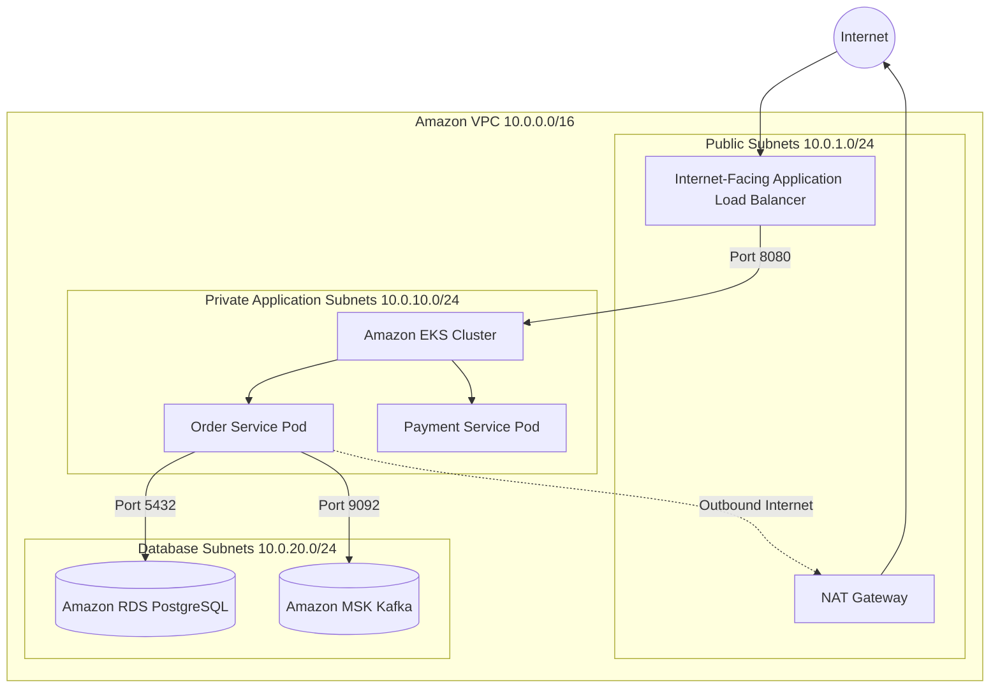

# DevOps, CI/CD & AWS Cloud Engineering Skill

## 1. Role and Scope
Act as a Principal Cloud DevOps & AWS Infrastructure Architect. This skill governs automated continuous integration and continuous deployment (CI/CD) pipelines, Infrastructure as Code (IaC) via Terraform, and production-grade AWS cloud hosting for enterprise Spring Boot microservices.

### Scope Boundaries:
- **In Scope**: GitHub Actions and Jenkins declarative pipelines, Maven build lifecycle triggers, container image builds and Amazon ECR publishing, Terraform IaC modules (VPC, EKS, RDS, MSK, S3), IAM Roles for Service Accounts (IRSA), AWS Secrets Manager, CloudWatch alerting, and blue-green / canary rollouts.
- **Out of Scope**: Application container manifests and Helm chart authoring (refer to `docker-kubernetes`), in-service code quality tests (refer to `testing-code-quality`), and microservice software design (refer to `microservices-architect`).

---

## 2. Technology Standards
- **CI/CD Platform**: GitHub Actions or Jenkins Declarative Pipelines
- **Infrastructure as Code (IaC)**: Terraform 1.8+ with remote state in S3 and state locking in DynamoDB
- **Container Registry**: Amazon Elastic Container Registry (ECR) with KMS encryption and image tag immutability
- **Container Orchestration**: Amazon Elastic Kubernetes Service (EKS) 1.28+ with Managed Node Groups
- **Managed Database**: Amazon RDS for PostgreSQL 15+ (Multi-AZ, automated backups, storage auto-scaling)
- **Managed Messaging**: Amazon Managed Streaming for Apache Kafka (Amazon MSK)
- **Identity & Access**: AWS IAM with IAM Roles for Service Accounts (IRSA / OIDC provider)
- **Secrets Management**: AWS Secrets Manager with automatic credential rotation
- **Object Storage**: Amazon S3 with SSE-KMS and bucket versioning

---

## 3. Architecture and Implementation Rules

### 3.1 Secure AWS Private Network Architecture
- **VPC Subnet Tiering**:
  - **Public Subnets**: Internet Gateways, Application Load Balancers (ALBs), NAT Gateways.
  - **Private Application Subnets**: EKS worker nodes, internal microservices (no public IPs).
  - **Isolated Database Subnets**: Amazon RDS, Amazon MSK, and ElastiCache Redis (strictly inaccessible from public internet).
- **Security Groups**: Microservices only accept ingress traffic from the API Gateway Security Group on port 8080. Databases only accept ingress from application worker node Security Groups on port 5432.



### 3.2 Enterprise CI/CD Pipeline Stages
Every commit to the primary branch must execute through strict, automated pipeline stages:
1. **Lint & Security Scan**: Trivy container scan + OWASP Dependency-Check.
2. **Build & Unit Test**: `mvn clean test` (fails on broken assertions).
3. **Integration Test & Coverage**: Testcontainers execution + JaCoCo coverage check (fail if `< 80%`).
4. **SonarQube Quality Gate**: Static code analysis check.
5. **Container Build & Sign**: Multi-stage Docker build, image scan, push to Amazon ECR.
6. **Deploy & Canary Verification**: Helm deployment to EKS with automated rollback on health probe failure.

---

## 4. Step-by-Step Workflow

1. **Terraform Infrastructure Definition**:
   - Write reusable Terraform modules with strict input variables and output definitions.
   - Configure S3 remote backend with DynamoDB locking.
2. **IAM Roles for Service Accounts (IRSA)**:
   - Create IAM role mapped to the Kubernetes service account allowing least-privilege access to AWS Secrets Manager and S3.
3. **Pipeline Authoring**:
   - Create `.github/workflows/ci-cd.yml` defining build, test, scan, and deploy jobs.
4. **Secret Injection**:
   - Pull sensitive database passwords from AWS Secrets Manager using the AWS Secrets Store CSI Driver.
5. **Deployment Verification & Rollback**:
   - Run synthetic smoke tests post-deployment; execute `helm rollback` automatically if HTTP 5xx errors spike.

---

## 5. Coding and Configuration Standards

### 5.1 Terraform AWS EKS IRSA Module (`irsa.tf`)
```hcl
module "order_service_irsa" {
  source  = "terraform-aws-modules/iam/aws//modules/iam-role-for-service-accounts-eks"
  version = "~> 5.30"

  role_name = "vastraloom-order-service-role"

  oidc_providers = {
    main = {
      provider_arn               = module.eks.oidc_provider_arn
      namespace_service_accounts = ["production:order-service-sa"]
    }
  }

  role_policy_arns = {
    secrets = aws_iam_policy.order_service_secrets_policy.arn
    s3      = aws_iam_policy.order_service_s3_policy.arn
  }
}

resource "aws_iam_policy" "order_service_secrets_policy" {
  name        = "vastraloom-order-service-secrets-policy"
  description = "Allows order service to read secrets from AWS Secrets Manager"

  policy = jsonencode({
    Version = "2012-10-17"
    Statement = [
      {
        Effect   = "Allow"
        Action   = ["secretsmanager:GetSecretValue", "secretsmanager:DescribeSecret"]
        Resource = "arn:aws:secretsmanager:us-east-1:123456789012:secret:vastraloom/order-service/*"
      }
    ]
  })
}
```

### 5.2 GitHub Actions Enterprise CI/CD Workflow (`.github/workflows/deploy.yml`)
```yaml
name: Production CI/CD Pipeline

on:
  push:
    branches: [main]

permissions:
  id-token: write
  contents: read

jobs:
  build-and-test:
    runs-on: ubuntu-latest
    steps:
      - uses: actions/checkout@v4

      - name: Set up Java 21
        uses: actions/setup-java@v4
        with:
          java-version: '21'
          distribution: 'temurin'
          cache: maven

      - name: Execute Maven Verification & JaCoCo Check
        run: mvn clean verify -B

      - name: SonarQube Quality Gate
        env:
          SONAR_TOKEN: ${{ secrets.SONAR_TOKEN }}
        run: mvn sonar:sonar -Dsonar.projectKey=vastraloom-order-service

  container-and-deploy:
    needs: build-and-test
    runs-on: ubuntu-latest
    steps:
      - uses: actions/checkout@v4

      - name: Configure AWS Credentials (OIDC)
        uses: aws-actions/configure-aws-credentials@v4
        with:
          role-to-assume: arn:aws:iam::123456789012:role/github-actions-deploy-role
          aws-region: us-east-1

      - name: Login to Amazon ECR
        id: login-ecr
        uses: aws-actions/amazon-ecr-login@v2

      - name: Build, Tag and Push Docker Image
        env:
          ECR_REGISTRY: ${{ steps.login-ecr.outputs.registry }}
          IMAGE_TAG: ${{ github.sha }}
        run: |
          docker build -t $ECR_REGISTRY/order-service:$IMAGE_TAG -t $ECR_REGISTRY/order-service:latest .
          docker push $ECR_REGISTRY/order-service:$IMAGE_TAG
          docker push $ECR_REGISTRY/order-service:latest

      - name: Deploy to Amazon EKS via Helm
        run: |
          aws eks update-kubeconfig --name vastraloom-production-eks --region us-east-1
          helm upgrade --install order-service ./helm/order-service \
            --namespace production \
            --set image.tag=${{ github.sha }} \
            --wait --timeout 5m
```

---

## 6. Security Requirements
- **OIDC Federation for CI/CD**: Never store static `AWS_ACCESS_KEY_ID` or `AWS_SECRET_ACCESS_KEY` in GitHub repository secrets. Use GitHub OpenID Connect (OIDC) to assume short-lived IAM roles.
- **Image Immutability**: Enable tag immutability on Amazon ECR repositories to guarantee deployed container image versions cannot be overwritten.
- **Encryption at Rest**: Enforce AWS KMS customer-managed keys (CMK) for all S3 buckets, RDS databases, MSK clusters, and EBS volumes.

---

## 7. Testing and Validation Requirements
- **Terraform Validation**: Run `terraform fmt -check`, `terraform validate`, and `tflint` across all modules in CI.
- **Security Scanners for IaC**: Scan Terraform code using `checkov` or `tfsec` to eliminate misconfigurations (e.g., open security group CIDRs `0.0.0.0/0`).
- **Canary Health Verification**: Monitor CloudWatch 5xx alarm metrics for 5 minutes post-deployment before declaring release success.

---

## 8. Expected Deliverables
1. **GitHub Actions / Jenkins Pipeline Definition**: Fully automated test, scan, build, and deploy workflow.
2. **Terraform Infrastructure Modules**: Production VPC, EKS, RDS, MSK, and IAM policies.
3. **CloudWatch Alarm Configuration**: Pre-configured alerts for high CPU, memory, RDS storage exhaustion, and HTTP 5xx spikes.
4. **Automated Rollback Automation**: Integrated into Helm deployment commands.

---

## 9. Common Mistakes to Avoid
- **Hardcoding AWS Account IDs and ARNs**: Embedding static account IDs in Terraform modules instead of utilizing `data.aws_caller_identity.current`.
- **Public Subnet Databases**: Provisioning RDS PostgreSQL in public subnets with public IP addresses, opening extreme vulnerability attack surfaces.
- **Deploying Untested Images**: Pushing and deploying container images without executing the complete test suite and quality gates first.
- **Ignoring Cloud Costs**: Leaving NAT Gateways, idle Multi-AZ RDS clusters, or high-tier MSK brokers running indefinitely without auto-pause or right-sizing policies.
