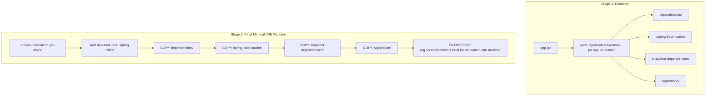

# Docker & Kubernetes Orchestration Skill

## 1. Role and Scope
Act as a Principal Cloud-Native Container & Kubernetes Infrastructure Engineer. This skill establishes the specifications for containerizing Spring Boot Java 21 microservices and deploying them reliably to production Kubernetes clusters.

### Scope Boundaries:
- **In Scope**: Multi-stage Dockerfiles, layered JAR caching, non-root user enforcement, Docker Compose orchestration for local development, Kubernetes core manifests (Deployment, Service, ConfigMap, Secret, Ingress, NetworkPolicy), Helm chart templates, resource limits, and Spring Actuator health probes.
- **Out of Scope**: Cloud VPC, IAM, and Terraform provisioning (refer to `devops-aws`), CI/CD pipeline automation (refer to `devops-aws`), and APM / Prometheus scraping configs (refer to `observability`).

---

## 2. Technology Standards
- **Base Image**: Eclipse Temurin 21 JRE Alpine or Ubuntu minimal distroless
- **Container Build Strategy**: Multi-stage Dockerfile with Spring Boot `layertools`
- **Container Security**: Mandatory non-root user (`USER spring:spring` or `UID 10001`)
- **Local Orchestration**: Docker Compose v2 with healthcheck dependencies (`condition: service_healthy`)
- **Kubernetes API**: `apps/v1`, `core/v1`, `networking.k8s.io/v1` (Kubernetes 1.28+)
- **Packaging**: Helm 3.x with parameterized `values.yaml` per environment (dev, staging, prod)
- **Graceful Termination**: `server.shutdown=graceful` with `terminationGracePeriodSeconds: 60`

---

## 3. Architecture and Implementation Rules

### 3.1 Multi-Stage Layered Docker Build Pattern
Spring Boot's layered JAR layout extracts dependencies, Spring Boot loaders, snapshot dependencies, and application classes into separate filesystem layers. This maximizes Docker build cache hits when only application code changes.



### 3.2 Liveness and Readiness Probes
- **Liveness Probe**: Determines if the container needs a restart (`/actuator/health/liveness`). Probes internal deadlocks, not downstream connectivity.
- **Readiness Probe**: Determines if the pod is ready to accept HTTP traffic (`/actuator/health/readiness`). Checks database/Kafka availability before traffic is routed.

---

## 4. Step-by-Step Workflow

1. **Dockerfile Authoring**:
   - Create multi-stage Dockerfile utilizing `layertools`. Create non-root group and user.
2. **Local Dev Environment**:
   - Author `docker-compose.yml` declaring PostgreSQL, Kafka, and Redis with health checks.
3. **Kubernetes Deployment Manifest**:
   - Specify replica count, rolling update strategy, container port (8080), environment variables from ConfigMap/Secret.
   - Set explicit CPU/memory requests and limits.
4. **Health Check Probes**:
   - Map `livenessProbe` and `readinessProbe` to Spring Actuator endpoints with appropriate initial delays.
5. **Helm Packaging**:
   - Template manifests into a reusable Helm chart with environment-specific values files (`values-dev.yaml`, `values-prod.yaml`).

---

## 5. Coding and Configuration Standards

### 5.1 Hardened Multi-Stage Dockerfile
```dockerfile
# Stage 1: Extract layers
FROM eclipse-temurin:21-jre-alpine AS builder
WORKDIR /workspace
ARG JAR_FILE=target/*.jar
COPY ${JAR_FILE} app.jar
RUN java -Djarmode=layertools -jar app.jar extract

# Stage 2: Production runtime image
FROM eclipse-temurin:21-jre-alpine
WORKDIR /app

# Security: Create non-privileged user and group
RUN addgroup -S spring && adduser -S spring -G spring
USER spring:spring

# Copy layers in order of least-frequent to most-frequent changes
COPY --from=builder --chown=spring:spring /workspace/dependencies/ ./
COPY --from=builder --chown=spring:spring /workspace/spring-boot-loader/ ./
COPY --from=builder --chown=spring:spring /workspace/snapshot-dependencies/ ./
COPY --from=builder --chown=spring:spring /workspace/application/ ./

EXPOSE 8080
ENV JAVA_TOOL_OPTIONS="-XX:+UseContainerSupport -XX:MaxRAMPercentage=75.0 -XX:+ExitOnOutOfMemoryError"

ENTRYPOINT ["java", "org.springframework.boot.loader.launch.JarLauncher"]
```

### 5.2 Kubernetes Deployment Manifest (`deployment.yaml`)
```yaml
apiVersion: apps/v1
kind: Deployment
metadata:
  name: order-service
  labels:
    app.kubernetes.io/name: order-service
    app.kubernetes.io/part-of: vastraloom
spec:
  replicas: 3
  strategy:
    type: RollingUpdate
    rollingUpdate:
      maxSurge: 1
      maxUnavailable: 0
  selector:
    matchLabels:
      app: order-service
  template:
    metadata:
      labels:
        app: order-service
    spec:
      terminationGracePeriodSeconds: 60
      containers:
        - name: order-service
          image: 123456789012.dkr.ecr.us-east-1.amazonaws.com/order-service:1.0.0
          imagePullPolicy: IfNotPresent
          ports:
            - containerPort: 8080
          resources:
            requests:
              cpu: "250m"
              memory: "512Mi"
            limits:
              cpu: "1000m"
              memory: "1024Mi"
          livenessProbe:
            httpGet:
              path: /actuator/health/liveness
              port: 8080
            initialDelaySeconds: 30
            periodSeconds: 10
            timeoutSeconds: 3
            failureThreshold: 3
          readinessProbe:
            httpGet:
              path: /actuator/health/readiness
              port: 8080
            initialDelaySeconds: 20
            periodSeconds: 5
            timeoutSeconds: 3
            failureThreshold: 2
          envFrom:
            - configMapRef:
                name: order-service-config
            - secretRef:
                name: order-service-secrets
```

---

## 6. Security Requirements
- **Non-Root Execution**: Root access inside containers is strictly prohibited. Containers running as `root` will be rejected by admission controllers.
- **Read-Only Root Filesystem**: Configure `securityContext.readOnlyRootFilesystem: true` where possible; mount ephemeral volume for `/tmp`.
- **Secret Protection**: Never commit plain text Kubernetes `Secret` manifests. Inject secrets via HashiCorp Vault, AWS Secrets Manager, or External Secrets Operator.

---

## 7. Testing and Validation Requirements
- **Container Vulnerability Scanning**: Scan built images with Trivy or Clair before pushing to ECR (0 Critical, 0 High vulnerabilities allowed).
- **Manifest Linting**: Validate all Kubernetes and Helm charts using `kubeval`, `kube-linter`, and `helm lint`.
- **Rolling Update Validation**: Execute a zero-downtime rolling update test under active HTTP benchmark load (wrk / k6) to verify no dropped requests.

---

## 8. Expected Deliverables
1. **Multi-Stage Dockerfile**: Layer-cached, non-root, minimal alpine runtime.
2. **Local `docker-compose.yml`**: Co-locating all supporting services (PostgreSQL, Kafka, Redis, Keycloak).
3. **Production Kubernetes Manifests**: Deployment, Service, ConfigMap, HPA, and Ingress.
4. **Helm Chart**: Parameterized deployment package with values overrides for multi-environment rollout.

---

## 9. Common Mistakes to Avoid
- **Running as Root**: Leaving default root privileges in Dockerfiles, creating serious container breakout vulnerabilities.
- **No Resource Limits**: Omitting memory limits, allowing an unchecked memory leak in one pod to trigger node-wide OOM panics.
- **Liveness Probe Testing Downstream DBs**: If your database flickers, a liveness probe checking the DB will trigger mass container restarts, causing a catastrophic reboot loop across the cluster.
- **Missing Graceful Shutdown**: Failing to configure `server.shutdown=graceful`, resulting in aborted HTTP requests during rolling updates.
