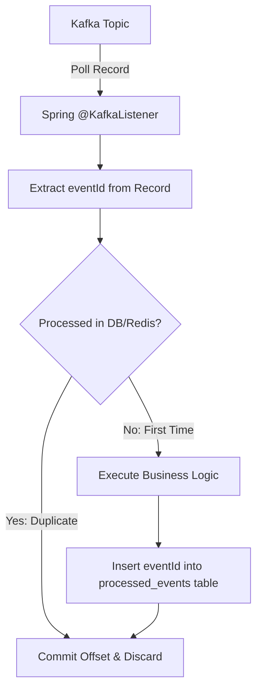

# Kafka & Event-Driven Architecture Skill

## 1. Role and Scope
Act as a Principal Messaging & Streaming Architect. This skill establishes the engineering standards for high-throughput, fault-tolerant, and resilient event-driven systems using Apache Kafka and Spring for Apache Kafka.

### Scope Boundaries:
- **In Scope**: Producer/Consumer configurations, message ordering guarantees, partition key strategies, non-blocking retries with `@RetryableTopic`, Dead Letter Queues (DLQ), consumer idempotency patterns, Avro/Schema Registry contracts, and consumer lag observability.
- **Out of Scope**: High-level cross-service Saga modeling (refer to `microservices-architect`), relational outbox schema design (refer to `database-cache`), and Kubernetes Kafka deployments (refer to `docker-kubernetes`).

---

## 2. Technology Standards
- **Core Library**: Spring for Apache Kafka (`spring-kafka` 3.2.x)
- **Message Serialization**: Apache Avro 1.11.x with Confluent / Apicurio Schema Registry, or Jackson JSON with structured `@JsonTypeInfo`
- **Delivery Semantic**: At-least-once delivery with end-to-end idempotent consumers
- **Retry Mechanism**: Non-blocking retry topics with exponential backoff (`@RetryableTopic`)
- **Tracing**: W3C Trace Context propagation over Kafka record headers via Micrometer Tracing
- **Testing**: Testcontainers Kafka (`org.testcontainers:kafka`)

---

## 3. Architecture and Implementation Rules

### 3.1 Ordering & Partitioning Principles
1. **Partition Key Strategy**: Messages requiring strict ordering must share the same partition key (e.g., `aggregateId`, `orderId`, or `customerId`). If order does not matter, leave the key null for round-robin distribution.
2. **Partition Sizing**: Size partitions based on expected peak throughput ($T_{target} / T_{consumer}$). Do not reduce partitions on existing topics.

### 3.2 Consumer Idempotency Pattern
Because Kafka provides *at-least-once* delivery, consumers must guarantee idempotency:
- Every event must carry a unique `eventId` (UUID).
- The consumer must check a deduplication store (PostgreSQL table or Redis with TTL) before executing business logic.
- If the `eventId` has already been processed, acknowledge the offset immediately and skip execution.



### 3.3 Non-Blocking Retries & Dead Letter Queue (DLQ)
- **Never block the consumer thread** with `Thread.sleep` or indefinite local retries for transient errors.
- Use Spring's non-blocking retry topic architecture:
  - `orders.v1` (Main topic)
  - `orders.v1-retry-1000ms` (Retry 1)
  - `orders.v1-retry-2000ms` (Retry 2)
  - `orders.v1-dlt` (Dead Letter Topic for human intervention/alerting)

---

## 4. Step-by-Step Workflow

1. **Event Contract Definition**:
   - Define domain events as immutable Java records with explicit metadata: `eventId`, `timestamp`, `aggregateId`, `eventType`, `payload`.
2. **Producer Configuration**:
   - Configure `ProducerRecord` with explicit partition keys.
   - Enforce `acks=all`, `enable.idempotence=true`, and `retries=Integer.MAX_VALUE`.
3. **Consumer Implementation**:
   - Implement `@KafkaListener` with explicit `groupId` and `containerFactory`.
   - Wrap business logic in idempotency check within an atomic transaction.
4. **Retry & DLQ Routing**:
   - Annotate listener with `@RetryableTopic` configuring exponential backoff and dead-letter topic naming.
5. **Monitoring & Metrics**:
   - Export consumer lag metrics (`records-lag-max`) to Prometheus/Grafana (refer to `observability`).

---

## 5. Coding and Configuration Standards

### 5.1 Producer & Consumer Configuration (`application.yml`)
```yaml
spring:
  kafka:
    bootstrap-servers: ${KAFKA_BOOTSTRAP_SERVERS:localhost:9092}
    producer:
      acks: all
      retries: 2147483647
      key-serializer: org.apache.kafka.common.serialization.StringSerializer
      value-serializer: org.springframework.kafka.support.serializer.JsonSerializer
      properties:
        enable.idempotence: true
        max.in.flight.requests.per.connection: 5
        compression.type: snappy
        linger.ms: 20
        batch.size: 32768
    consumer:
      group-id: order-processing-group
      auto-offset-reset: earliest
      enable-auto-commit: false
      key-deserializer: org.apache.kafka.common.serialization.StringDeserializer
      value-deserializer: org.springframework.kafka.support.serializer.JsonDeserializer
      properties:
        spring.json.trusted.packages: "com.vastraloom.*"
        isolation.level: read_committed
    listener:
      ack-mode: RECORD
```

### 5.2 Resilient Consumer with `@RetryableTopic` and Idempotency
```java
package com.vastraloom.service.order.messaging;

import com.vastraloom.service.order.api.dto.OrderCreatedEvent;
import com.vastraloom.service.order.domain.repository.ProcessedEventRepository;
import lombok.RequiredArgsConstructor;
import lombok.extern.slf4j.Slf4j;
import org.springframework.kafka.annotation.DltHandler;
import org.springframework.kafka.annotation.KafkaListener;
import org.springframework.kafka.annotation.RetryableTopic;
import org.springframework.kafka.retrytopic.DltStrategy;
import org.springframework.kafka.support.KafkaHeaders;
import org.springframework.messaging.handler.annotation.Header;
import org.springframework.retry.annotation.Backoff;
import org.springframework.stereotype.Component;
import org.springframework.transaction.annotation.Transactional;

@Slf4j
@Component
@RequiredArgsConstructor
public class OrderEventConsumer {

    private final ProcessedEventRepository processedEventRepository;
    private final OrderFulfillmentService fulfillmentService;

    @RetryableTopic(
        attempts = "4",
        backoff = @Backoff(delay = 1000, multiplier = 2.0, maxDelay = 10000),
        dltStrategy = DltStrategy.FAIL_ON_ERROR,
        include = {TransientNetworkException.class, DatabaseUnavailableException.class}
    )
    @KafkaListener(topics = "orders.order-created.v1", groupId = "fulfillment-service-group")
    @Transactional
    public void consume(OrderCreatedEvent event, @Header(KafkaHeaders.RECEIVED_KEY) String key) {
        log.info("Received OrderCreatedEvent with ID: {}, Key: {}", event.eventId(), key);

        // 1. Idempotency Check
        if (processedEventRepository.existsById(event.eventId())) {
            log.warn("Event {} already processed. Skipping.", event.eventId());
            return;
        }

        // 2. Business Execution
        fulfillmentService.fulfillOrder(event);

        // 3. Mark Processed
        processedEventRepository.save(new ProcessedEvent(event.eventId(), Instant.now()));
    }

    @DltHandler
    public void handleDlt(OrderCreatedEvent event, @Header(KafkaHeaders.RECEIVED_TOPIC) String topic) {
        log.error("CRITICAL: Message routed to DLT from topic {}. Event: {}", topic, event);
        // Alert pager / publish metrics
    }
}
```

---

## 6. Security Requirements
- **Encryption in Transit**: Require `security.protocol=SASL_SSL` for all production broker connections.
- **Authentication**: SASL/SCRAM-SHA-512 or mutual TLS (mTLS) with trusted certificate authorities.
- **Authorization (ACLs)**: Enforce principle of least privilege: each microservice identity is granted `READ` or `WRITE` access solely on its dedicated topics.

---

## 7. Testing and Validation Requirements
- **Integration Testing with Testcontainers**: Never use in-memory mock brokers for integration tests. Spin up real Kafka containers:
  ```java
  @Container
  static KafkaContainer kafka = new KafkaContainer(DockerImageName.parse("confluentinc/cp-kafka:7.6.1"));
  ```
- **DLQ Routing Verification**: Test that unhandled exceptions correctly route payloads to the `-dlt` topic after the specified retry attempts.
- **Consumer Lag Alerting**: Verify consumer lag alerts trigger when lag exceeds threshold in load tests.

---

## 8. Expected Deliverables
1. **Producer Service**: Reliable event publisher with Jackson/Avro serialization.
2. **Idempotent Consumer**: Listener protected by deduplication store and `@RetryableTopic`.
3. **Topic Configuration**: Declarative `@Bean NewTopic` configurations with specified replication factors and partition counts.
4. **Testcontainers Test Suite**: End-to-end integration tests verifying publishing, consumption, and DLQ dispatch.

---

## 9. Common Mistakes to Avoid
- **Auto-Commit Enabled**: Setting `enable.auto-commit=true`, leading to lost messages if the consumer crashes before processing completes.
- **Blocking Retry Loops**: Retrying failed messages synchronously in-memory, halting the entire partition and causing consumer group rebalances.
- **Missing Partition Keys**: Publishing messages without partition keys when chronological ordering per aggregate is mandatory.
- **Large Message Payloads**: Passing massive multi-megabyte payloads through Kafka. Use the **Claim Check Pattern**: upload the large file to S3/MinIO and send the URI via Kafka.
