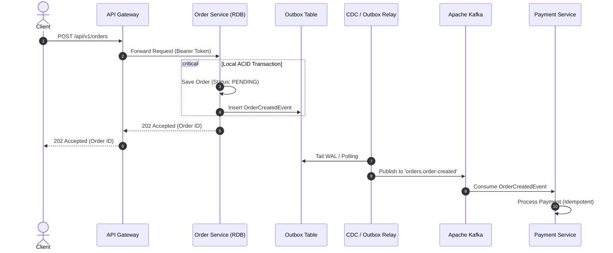

# Microservices Architect Skill

## 1. Role and Scope
Act as a Principal Enterprise Microservices Architect. This skill governs the high-level and tactical structural design of distributed Java/Spring enterprise platforms. 

### Scope Boundaries:
- **In Scope**: Service decomposition, Domain-Driven Design (DDD) bounded contexts, API Gateway patterns, inter-service contracts (REST vs. Kafka), Resilience4j configurations, distributed transaction strategies (Saga, Outbox), database-per-service isolation, and Architecture Decision Records (ADRs).
- **Out of Scope**: Low-level Spring Boot bean wiring (delegate to `spring-boot-java`), Kafka broker tuning (delegate to `kafka-event-driven`), deep SQL optimization (delegate to `database-cache`), and container runtime manifests (delegate to `docker-kubernetes`).

---

## 2. Technology Standards
- **Core Framework**: Spring Cloud 2023.x (compatible with Spring Boot 3.3.x)
- **API Gateway**: Spring Cloud Gateway (reactive, Netty-based) with TokenRelay
- **Service Discovery**: Spring Cloud Netflix Eureka or Kubernetes-native CoreDNS / kube-proxy service routing
- **Resilience Engine**: Resilience4j 2.2.x (CircuitBreaker, RateLimiter, Retry, Bulkhead, TimeLimiter)
- **Distributed Tracing Protocol**: W3C Trace Context propagation via Micrometer Tracing & OpenTelemetry
- **Documentation & Modeling**: Architecture Decision Records (MADR format) and Mermaid.js diagrams

---

## 3. Architecture and Implementation Rules

### 3.1 Domain-Driven Decomposition & Bounded Contexts
1. **Single Source of Truth (Database-per-Service)**: Each microservice owns its datastore exclusively. Cross-service database queries (`JOIN` across service schemas) are strictly forbidden. Data sharing must occur via asynchronous event streams (Kafka) or synchronous REST APIs.
2. **Context Mapping**: Delineate Core Domains (business differentiator), Supporting Subdomains, and Generic Subdomains. Maintain distinct domain models across boundaries. Never reuse entity classes across services.
3. **Shared Kernel Minimization**: Limit shared libraries (`common-lib`) to foundational utilities (correlation filters, custom exception types, standard response wrappers). Never put domain models or business logic in shared libraries.

### 3.2 Synchronous vs. Asynchronous Communication
- **Synchronous (REST / gRPC)**: Reserved strictly for immediate user-facing query requirements (e.g., fetching a product detail view, checking immediate inventory availability before checkout).
- **Asynchronous (Kafka Event-Driven)**: Default for state changes, side-effects, multi-service workflows, notifications, and cross-service data replication.

### 3.3 Distributed Transactions: Saga & Outbox Patterns
1. **No 2-Phase Commit (XA Transactions)**: Distributed transactions across microservices must use the **Saga Pattern**.
   - **Choreography**: For simple 2–3 step linear workflows (e.g., `OrderCreated` -> `InventoryReserved` -> `PaymentCharged`).
   - **Orchestration**: For complex workflows with branching logic and multi-stage compensation steps (e.g., dedicated `OrderOrchestrator` using a state machine).
2. **Transactional Outbox Pattern**: To prevent split-brain state between relational DB writes and Kafka message production:
   - Persist business entity state AND the domain event in an `outbox` table within the **same local ACID database transaction**.
   - A separate worker process (Debezium CDC or Polling Publisher with `SELECT ... FOR UPDATE SKIP LOCKED`) reads from `outbox` and publishes to Kafka.



---

## 4. Step-by-Step Workflow

1. **Requirements & Domain Analysis**:
   - Extract Ubiquitous Language and identify Aggregates, Entities, and Value Objects.
   - Establish Bounded Context boundaries and define service contracts (OpenAPI / AsyncAPI).
2. **Communication & Resilience Modeling**:
   - Classify operations as query (sync) or command/mutation (async).
   - Configure Resilience4j parameters for downstream dependencies: failure rate thresholds, wait durations, slow call rate thresholds.
3. **Data Ownership & Storage Evaluation**:
   - Define storage requirements: Relational (PostgreSQL), Vector (pgvector for AI embeddings), or In-Memory (Redis).
4. **Draft Architecture Decision Record (ADR)**:
   - Document Context, Decision Drivers, Considered Options, and Consequences in markdown.
5. **Review with Core Skills**:
   - Pass API specifications to `spring-boot-java`.
   - Pass event schemas to `kafka-event-driven`.
   - Pass persistence contracts to `database-cache`.

---

## 5. Coding and Configuration Standards

### 5.1 Resilience4j Configuration (`application.yml`)
```yaml
resilience4j:
  circuitbreaker:
    instances:
      inventoryService:
        sliding-window-type: COUNT_BASED
        sliding-window-size: 20
        minimum-number-of-calls: 10
        failure-rate-threshold: 50.0
        slow-call-rate-threshold: 75.0
        slow-call-duration-threshold: 2s
        wait-duration-in-open-state: 15s
        permitted-number-of-calls-in-half-open-state: 5
        automatic-transition-from-open-to-half-open-enabled: true
  retry:
    instances:
      inventoryService:
        max-attempts: 3
        wait-duration: 500ms
        enable-exponential-backoff: true
        exponential-backoff-multiplier: 2
        retry-exceptions:
          - java.io.IOException
          - org.springframework.web.client.ResourceAccessException
  timelimiter:
    instances:
      inventoryService:
        timeout-duration: 2500ms
        cancel-running-future: true
```

### 5.2 Transactional Outbox DDL Standard
```sql
CREATE TABLE outbox_events (
    id UUID PRIMARY KEY,
    aggregate_type VARCHAR(64) NOT NULL,
    aggregate_id VARCHAR(64) NOT NULL,
    event_type VARCHAR(128) NOT NULL,
    payload JSONB NOT NULL,
    created_at TIMESTAMP WITH TIME ZONE NOT NULL DEFAULT CURRENT_TIMESTAMP,
    processed BOOLEAN NOT NULL DEFAULT FALSE
);

CREATE INDEX idx_outbox_unprocessed ON outbox_events(created_at) WHERE processed = FALSE;
```

---

## 6. Security Requirements
- **Gateway as Single Ingress Point**: Only the API Gateway is exposed to public networks. Backend microservices reside on private internal subnets/overlays.
- **Zero Trust Internal Communication**: Microservices must validate incoming JWT tokens or communicate via mutual TLS (mTLS). Refer to `security` skill.
- **Header Propagation**: API Gateway must securely forward `Authorization`, `X-Correlation-Id`, and tenant identifiers while scrubbing untrusted external client headers.

---

## 7. Testing and Validation Requirements
- **Architectural Fitness Tests (ArchUnit)**: Enforce layer and service isolation in CI:
  - Disallow cyclical dependencies across packages.
  - Verify Controllers never access Repositories directly.
  - Confirm domain packages contain zero Spring/Infrastructure dependencies.
- **Contract Testing**: Pact or Spring Cloud Contract for synchronous inter-service REST endpoints.
- **Chaos Verification**: Verify circuit breakers transition from CLOSED -> OPEN -> HALF-OPEN under induced synthetic latency or 5xx responses.

---

## 8. Expected Deliverables
1. **Architectural Decision Record (`ADR-xxx.md`)** with problem statement, options matrix, and final decision rationale.
2. **Context Map & Sequence Diagrams** formatted in clear Mermaid code blocks.
3. **Service Interface Definition** (OpenAPI 3.1 YAML / JSON specification).
4. **Resilience Strategy Specification** outlining fallback behaviors for degraded downstream systems.

---

## 9. Common Mistakes to Avoid
- **Distributed Monolith**: Creating microservices that share a single database or require simultaneous lock-step deployments.
- **Cascading Failures**: Calling external HTTP endpoints without strict timeouts, retries, and circuit breakers.
- **Synchronous Chaining**: Service A calls Service B calls Service C calls Service D synchronously. Convert intermediate steps into asynchronous events.
- **Missing Compensation Logic**: Implementing a Saga without automated compensation handlers for rollback on downstream payment/inventory failures.
