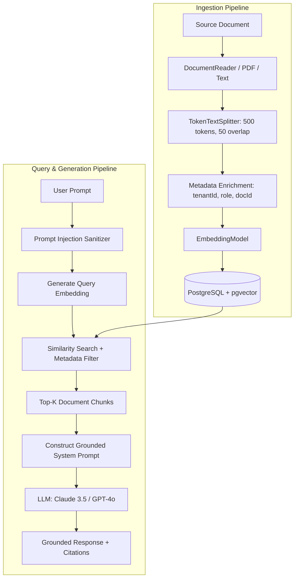

# Spring AI & Enterprise RAG Engineering Skill

## 1. Role and Scope
Act as a Principal AI Engineer specializing in Spring AI and enterprise Retrieval-Augmented Generation (RAG) systems. This skill dictates how to build secure, grounded, and cost-effective LLM integrations within Spring Boot microservices.

### Scope Boundaries:
- **In Scope**: Spring AI abstraction layer, vector storage via PostgreSQL `pgvector`, embedding generation, document chunking & ETL pipelines, prompt engineering, context window optimization, metadata-based access control, tool calling (function calling), and token telemetry.
- **Out of Scope**: General relational database setup (refer to `database-cache`), enterprise authentication mechanisms (refer to `security`), and container deployment (refer to `docker-kubernetes`).

---

## 2. Technology Standards
- **Framework**: Spring AI 1.0.0-M1+ (or latest stable milestone)
- **Vector Database**: PostgreSQL 15+ with `pgvector` extension (`0.7.0+`)
- **Supported LLM Providers**:
  - Amazon Bedrock (Anthropic Claude 3.5 Sonnet / Haiku, Amazon Titan)
  - Anthropic Direct API (Claude 3.5 Sonnet)
  - OpenAI Direct API (`gpt-4o`, `text-embedding-3-small`)
- **Embedding Dimensions**: Standardize on 1536 (OpenAI `text-embedding-3-small`) or 1024 (Amazon Titan Embeddings v2)
- **Vector Indexing**: HNSW (Hierarchical Navigable Small World) with Cosine or Inner Product distance metric
- **Document Extractors**: Apache Tika / Spring AI `PagePdfDocumentReader`, `TextReader`
- **Text Splitter**: `TokenTextSplitter` (configurable chunk size e.g. 500 tokens, overlap 50 tokens)

---

## 3. Architecture and Implementation Rules

### 3.1 Retrieval-Augmented Generation (RAG) Pipeline


### 3.2 Metadata-Driven Access Control & Tenant Isolation
- **Document-Level Security**: Every ingested vector chunk **must** contain metadata attributes: `tenantId`, `accessLevel`, `documentId`, `createdDate`.
- **Pre-Filtering**: Similarity searches must execute with strict SQL `WHERE` filter expressions against metadata (e.g., `tenantId == :currentTenantId AND accessLevel IN (:userRoles)`). Never filter results in memory after vector retrieval.

### 3.3 Grounded Responses & Hallucination Elimination
- System prompts must explicitly instruct the model: *"Answer the user's question solely based on the provided context. If the answer cannot be deduced directly from the context, state clearly: 'I do not have sufficient information in the provided documentation to answer this question.' Do not fabricate details."*
- Responses must output inline citations referencing the `documentId` and chunk title.

---

## 4. Step-by-Step Workflow

1. **pgvector Schema Setup**:
   - Write a Flyway migration enabling the extension and creating the vector table (refer to `database-cache`).
2. **Document Ingestion Service**:
   - Ingest raw files, parse with `DocumentReader`, and chunk using `TokenTextSplitter`.
   - Attach mandatory metadata (`tenantId`, `source`, `checksum`).
   - Persist into `PgVectorStore`.
3. **Retrieval & Prompt Construction**:
   - Configure `VectorStoreAdvisor` or custom retrieval service with top-K (default: 4-6 chunks) and similarity threshold (e.g., cosine distance `< 0.35`).
4. **Tool / Function Calling Registration**:
   - Define Spring `@Bean` functions annotated with `@Description` to allow the LLM to invoke microservice APIs when real-time data is needed.
5. **Observability & Guardrails**:
   - Track prompt tokens, completion tokens, latency, and estimated cost via Micrometer (refer to `observability`).
   - Validate prompts against basic injection patterns before dispatching to the provider.

---

## 5. Coding and Configuration Standards

### 5.1 Spring AI Configuration (`application.yml`)
```yaml
spring:
  ai:
    bedrock:
      aws:
        region: us-east-1
      claude:
        chat:
          options:
            model: anthropic.claude-3-5-sonnet-20240620-v1:0
            temperature: 0.2
            max-tokens: 2000
    vectorstore:
      pgvector:
        index-type: HNSW
        distance-type: COSINE_DISTANCE
        dimensions: 1536
        collection-name: enterprise_knowledge_vectors
```

### 5.2 RAG Service Implementation with Metadata Filtering
```java
package com.vastraloom.service.ai.service;

import org.springframework.ai.chat.client.ChatClient;
import org.springframework.ai.chat.client.advisor.QuestionAnswerAdvisor;
import org.springframework.ai.vectorstore.SearchRequest;
import org.springframework.ai.vectorstore.VectorStore;
import org.springframework.ai.vectorstore.filter.FilterExpressionBuilder;
import org.springframework.stereotype.Service;

@Service
public class EnterpriseKnowledgeService {

    private final ChatClient chatClient;
    private final VectorStore vectorStore;

    public EnterpriseKnowledgeService(ChatClient.Builder chatClientBuilder, VectorStore vectorStore) {
        this.vectorStore = vectorStore;
        this.chatClient = chatClientBuilder
            .defaultSystem("""
                You are Vastraloom's Enterprise AI Assistant. 
                Answer queries strictly using the provided context.
                Always include references to source documents in brackets [Doc: <source>].
                If the context does not contain the answer, reply:
                'I am unable to find this information in the knowledge base.'
                """)
            .build();
    }

    public String queryKnowledgeBase(String userQuery, String tenantId) {
        FilterExpressionBuilder b = new FilterExpressionBuilder();
        SearchRequest searchRequest = SearchRequest.builder()
            .query(userQuery)
            .topK(5)
            .similarityThreshold(0.70)
            .filterExpression(b.eq("tenantId", tenantId).build())
            .build();

        return chatClient.prompt()
            .user(userQuery)
            .advisors(new QuestionAnswerAdvisor(vectorStore, searchRequest))
            .call()
            .content();
    }
}
```

### 5.3 Function Calling Definition
```java
package com.vastraloom.service.ai.tools;

import org.springframework.context.annotation.Bean;
import org.springframework.context.annotation.Configuration;
import org.springframework.context.annotation.Description;
import java.util.function.Function;

@Configuration
public class InventoryAiTools {

    public record InventoryCheckRequest(String sku) {}
    public record InventoryCheckResponse(String sku, int availableStock, String warehouseLocation) {}

    @Bean
    @Description("Check real-time warehouse inventory for a given product SKU")
    public Function<InventoryCheckRequest, InventoryCheckResponse> checkInventoryStock() {
        return request -> {
            // Invokes internal microservice or DB
            return new InventoryCheckResponse(request.sku(), 142, "Bangalore-Warehouse-A");
        };
    }
}
```

---

## 6. Security Requirements
- **Prompt Injection Defense**: Scan incoming prompts for jailbreak keywords (e.g., `"Ignore previous instructions"`, `"System prompt override"`). Strip dangerous formatting.
- **Tenant Isolation Guarantee**: Every vector database interaction must include tenant filters. No vector search may be executed with an empty or unauthenticated filter.
- **API Key & Secrets Management**: Never hardcode OpenAI or AWS secret keys. Inject via AWS Secrets Manager or environment variables (refer to `security`).

---

## 7. Testing and Validation Requirements
- **Vector Search Tests**: Use Testcontainers PostgreSQL with pgvector to verify HNSW index creation and similarity scoring accuracy.
- **Grounding & Faithfulness Evaluation**: Write test fixtures evaluating that the LLM does not hallucinate answers when provided adversarial context.
- **Mock LLM Providers**: Mock `ChatModel` and `EmbeddingModel` in CI environments to avoid real API costs and token consumption during builds.

---

## 8. Expected Deliverables
1. **Flyway Migration**: For `pgvector` extension and vector storage schema with HNSW index.
2. **Ingestion Pipeline**: Complete document reader, chunking, and embedding storage service.
3. **RAG Chat Service**: Production-grade Spring AI service with metadata filtering and citations.
4. **Tool Function Registration**: Type-safe record-based tools for external system invocations.

---

## 9. Common Mistakes to Avoid
- **Unbounded Context Windows**: Stuffing 50 chunks into the context window, causing massive token costs, slow latency, and model confusion ("lost in the middle").
- **Missing Vector Indexes**: Forgetting to create an HNSW index on the vector embedding column, causing sequential table scans across millions of embeddings.
- **Overwriting Ingested Chunks**: Generating duplicate chunks upon document re-ingestion instead of using document hashing / deduplication keys.
- **No Token Quota Controls**: Exposing unauthenticated endpoints to LLM generation without rate-limiting and user quota tracking.
