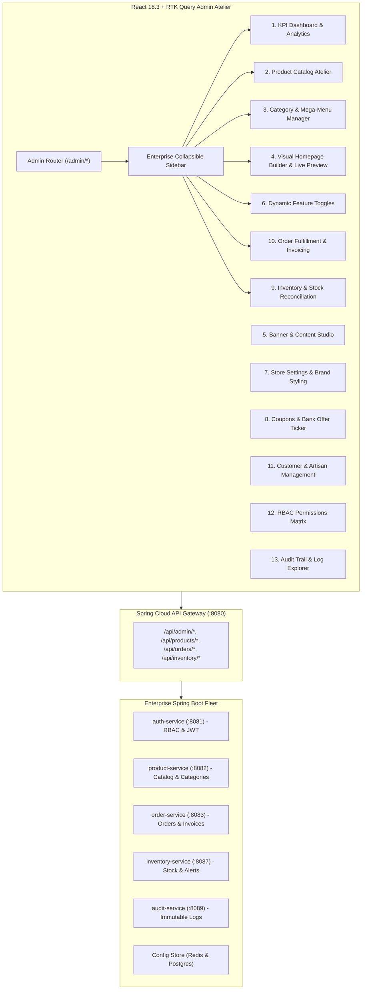

# Dynamic Admin Panel, Website Customization & E-Commerce Management Design

**Date**: 2026-11-06  
**Status**: DRAFT FOR APPROVAL  
**Author**: Enterprise Architecture Pair Programming  
**Branch Target**: `feat/dynamic-admin-panel`  
**Git Remote**: `https://github.com/sameerasha/khandualoom.git`

---

## 1. Executive Summary & Architectural Overview

The objective of this module is to provide Khandua Looms with an enterprise-grade, configuration-driven **Dynamic Admin Control Panel**. Authorized administrators can curate the product catalog, adjust live inventory with audit logging, manage the multi-stage order lifecycle, build and reorder homepage sections visually, toggle store features on/off dynamically, and configure promotional campaigns without requiring code modifications or deployments.

### High-Level Architecture

---

## 2. Admin Modules & Detailed Functional Specifications

### 2.1 Admin Dashboard & KPI Analytics
- **Executive Metrics**:
  - Total Revenue & Sales (with date filter: Today, Last 7 Days, Month-to-Date, All Time).
  - Order Volume (Pending, Confirmed, Shipped, Delivered, Cancelled).
  - Customer Patrons Count & Active Sessions.
  - Saree Catalog Metrics (Total SKUs, Active Listings, Low Stock `< 3`, Out of Stock `0`).
- **Data Visualizations**:
  - Revenue Trend Area Chart (daily/weekly gross merchandise value).
  - Category Share Donut Chart (Khandua Silk vs Sambalpuri Ikat vs Bomkai vs Pasapalli).
  - Recent Order Feed with one-click status inspection.
  - Top-Selling Artisan Masterpieces leaderboard.

### 2.2 Product Management & Catalog Atelier
- **CRUD Operations**:
  - Create, Edit, Archive, Duplicate, Publish, and Unpublish.
  - Scheduled publication (publishing at future timestamp).
- **Product Entity Coverage**:
  - Name, SKU, Slug, Short Description, Full Editorial Description.
  - Weave type, Fabric composition, GI Certification status, Silk Mark badge toggle.
  - Dimensions (Length: 5.5m saree + 0.8m blouse piece, Width: 46 inches, Weight in grams).
  - Price, MRP, Automated Discount Percentage Calculation.
  - High-res Image Gallery uploader with primary thumbnail designation.
  - Handloom Artisan attribution link.
- **Bulk Catalog Controls**:
  - Bulk publish / unpublish.
  - Bulk category reassignment.
  - Search and multi-criteria faceted filtering across categories, price, and stock levels.

### 2.3 Category & Mega-Menu Navigation Hierarchy
- **Tree-Structured Category Manager**:
  - Hierarchical nesting: Root Category ➔ Subcategory ➔ Weave Type (e.g., `Women` ➔ `Sarees` ➔ `Khandua Silk`).
  - Drag-and-drop or rank ordering of categories.
  - Category banner image, thumbnail badge, and editorial description.
  - Enable / disable toggle that immediately reflects in the Storefront mega-menu.
  - SEO Slug, Meta Title, and Meta Description per category.

### 2.4 Visual Homepage Builder & Live Device Preview
- **Modular Section Architecture**:
  - Hero Campaign Carousel (banners, headline, dual CTAs).
  - Category Tiles Grid.
  - Handloom Highlights / Trending Sarees (curated product selection).
  - Coupons Corner Promotion Block.
  - Artisan Spotlight & Weaving Heritage Narrative.
  - Newsletter & Patron Appraisal Strip.
- **Section Controls**:
  - Reorder sections via Up/Down controls or drag-and-drop.
  - Toggle visibility (`enabled: true/false`).
  - Device targeting: All, Desktop Only, Mobile Only.
  - Published vs. Draft state with one-click "Publish to Storefront".
  - **Live Preview Frame**: Split-screen preview with viewport toggles (Desktop 1440px, Tablet 768px, Mobile 375px).

### 2.5 Banner & Promotional Content Studio
- **Banner Placement Registry**:
  - Homepage Hero Carousel.
  - Category Header Banners.
  - Sticky Discount Tab (`"FLAT ₹300 OFF"` custom text).
  - Trust & Bank Offer Ticker (HDFC, Kotak, ICICI, Axis, Paytm).
- **Banner Configuration**:
  - Banner Title, Subtitle, CTA Button Label, Target URL / Route.
  - Desktop Image Asset URL + Mobile-optimized Image Asset URL.
  - Scheduled Start and End timestamps.
  - Live active indicator.

### 2.6 Dynamic Feature Management & Configuration
- **Centralized Feature Flags** that govern storefront behavior without deployments:
  - `feature.wishlist`: Enable / disable patron wishlist.
  - `feature.coupons`: Enable / disable promo coupon engine and Coupons Corner.
  - `feature.weaverDonation`: Enable / disable weaver welfare tipping tile in checkout.
  - `feature.threeDSheenCanvas`: Toggle 3D WebGL fabric inspector on PDP.
  - `feature.pincodeChecker`: Enable / disable real-time delivery ETA calculator.
  - `feature.guestCheckout`: Allow checkout without account registration.
  - `feature.reviewsAndRatings`: Patron appraisal submission system.
  - `feature.maintenanceMode`: Displays elegant maintenance screen to public visitors while allowing admin access.
- **Persistence**: Feature configurations stored in backend configuration state, cached in Redis, and distributed to frontend via RTK Query.

### 2.7 Pricing, Discounts & Coupon Engine
- **Coupon Builder**:
  - Coupon Code (e.g., `KHANDUA100`, `ROYALSILK10`).
  - Discount Type: `FLAT` (₹ rupees off) or `PERCENT` (% off).
  - Discount Value (e.g., `100` or `15`).
  - Minimum Cart Subtotal threshold (e.g., `₹1,999`).
  - Maximum Discount Cap (e.g., `₹500` for percent discounts).
  - Total usage limit & expiry datetime.
  - Applicable category / collection restrictions.
- **Promotional Strip Manager**:
  - Bank partner discounts management (Bank name, discount %, min spend, max discount).

### 2.8 Inventory & Stock Reconciliation Atelier
- **Real-Time Inventory Ledger**:
  - SKU-level available quantity and reserved quantity (in active checkouts).
  - Low-stock threshold indicator (`< 3` units).
  - Single-piece unique saree flag (`quantity = 1`).
- **Stock Adjustment Modal**:
  - Action: Restock, Write-off / Damaged, Inventory Audit Adjustment.
  - Required Reason input for audit compliance.
  - User signature and timestamp recorded to `audit-service`.

### 2.9 Order Fulfillment & Invoicing
- **Fulfillment State Machine**:
  - `CONFIRMED` ➔ `QUALITY_CHECK` ➔ `SHIPPED` ➔ `DELIVERED` ➔ `CANCELLED` / `RETURN_REQUESTED` ➔ `REFUNDED`.
- **Order Detail Drawer**:
  - Patron details, delivery address, ordered handloom pieces.
  - Tracking courier partner name and tracking number input.
  - One-click PDF/Print Invoice generator with Silk Mark and GI certification seal.
  - Return / refund request approval or rejection with reason.

### 2.10 RBAC Permissions & Audit Log Explorer
- **Granular Roles**:
  - `ROLE_SUPER_ADMIN`: Unrestricted access across all modules, configuration, and user management.
  - `ROLE_STORE_ADMIN`: Catalog, Banners, Homepage, Orders, and Coupons.
  - `ROLE_CATALOG_MANAGER`: Product CRUD, Category management, and image uploads only.
  - `ROLE_ORDER_MANAGER`: Order fulfillment, shipping updates, and return approvals.
- **Audit Log Explorer**:
  - Real-time search and filterable table querying `audit-service:8089`.
  - Columns: Timestamp, Admin Username, Module, Action (`CREATE`, `UPDATE`, `DELETE`, `STOCK_ADJUST`), Entity ID, Change Summary.

---

## 3. UI/UX Architecture & Layout Shell

The Admin Atelier maintains the royal luxury dark theme (`#0F0617`, `#170928`, `brand-gold`, `brand-ivory`) with clean enterprise administrative clarity:
- **Left Navigation Rail**: Collapsible sidebar with category groupings (Overview, Commerce, Experience, Governance).
- **Top Command Header**: Active store indicator, breadcrumbs, search shortcut (`Ctrl+K`), quick links to Storefront (`Open Live Store`), notification bell, and Admin Profile dropdown.
- **Data Table Standard**: Sortable columns, search input, filter chips, pagination (`10 / 25 / 50 per page`), row selection, and batch actions.
- **Slide-Out Drawers & Modals**: For product editing, section builder, stock adjustment, and order inspection.

---

## 4. Verification & Testing Strategy

1. **Jest Unit & Integration Tests**:
   - `AdminDashboard.test.tsx`: KPI cards and analytics calculation rendering.
   - `HomepageBuilder.test.tsx`: Section reordering and toggle visibility.
   - `FeatureManager.test.tsx`: Feature toggle mutations and state persistence.
   - `CouponManager.test.tsx`: Coupon CRUD and validation limits.
   - `InventoryAtelier.test.tsx`: Stock adjustment modal with audit dispatch.
2. **TypeScript Strict Typecheck**: Zero `tsc` errors.
3. **Vite Production Build**: Zero compilation warnings/errors.
4. **Git Remote Sync**: All commits pushed to `https://github.com/sameerasha/khandualoom.git`.
