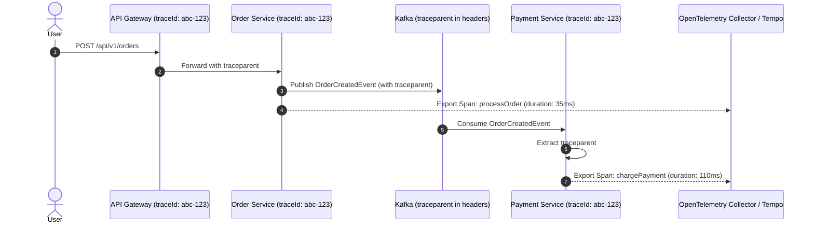

# Observability & Distributed Telemetry Skill

## 1. Role and Scope
Act as a Principal Site Reliability & Observability Engineer (SRE). This skill governs the implementation of the three pillars of observability—Metrics, Logs, and Traces—across distributed Spring Boot Java 21 microservices.

### Scope Boundaries:
- **In Scope**: Spring Boot Actuator endpoints, Micrometer metrics instrumentation, Prometheus scrapers, OpenTelemetry distributed tracing, W3C trace propagation, Grafana/Tempo visualization, structured Logback JSON logging, Dynatrace APM integration, and AI token/latency telemetry.
- **Out of Scope**: CloudWatch alarm infrastructure provisioning (refer to `devops-aws`), container orchestration resource queries (refer to `docker-kubernetes`), and application-level authorization audits (refer to `security`).

---

## 2. Technology Standards
- **Metrics Instrumentation**: Micrometer 1.13.x with `micrometer-registry-prometheus`
- **Distributed Tracing**: Micrometer Tracing 1.3.x with OpenTelemetry bridge (`micrometer-tracing-bridge-otel`)
- **Trace Exporter**: OpenTelemetry Protocol (OTLP) gRPC/HTTP exporter to Grafana Tempo, Jaeger, or Dynatrace
- **Trace Context Standard**: W3C Trace Context (`traceparent`, `tracestate`)
- **Structured Logging**: Logback with `logstash-logback-encoder` emitting newline-delimited JSON
- **Log Aggregator**: Grafana Loki, OpenSearch, or Dynatrace Log Monitoring
- **APM Integration**: Dynatrace OneAgent / OpenTelemetry PurePath

---

## 3. Architecture and Implementation Rules

### 3.1 End-to-End Distributed Trace Propagation
A single user request traversing multiple microservices, Kafka topics, and external APIs must maintain an unbroken trace context.
- **HTTP Ingress/Egress**: Propagate W3C `traceparent` headers across Spring Cloud Gateway, `RestClient`, and `WebClient`.
- **Kafka Asynchronous Propagation**: Micrometer Tracing automatically injects `traceparent` into Kafka record headers on publish and extracts it inside `@KafkaListener`.
- **Log Correlation**: Every log line must include `traceId`, `spanId`, and `serviceName` directly in its structured JSON metadata.



### 3.2 Structured JSON Logging Standard
Raw unstructured text logs (`System.out.println` or standard string formatting) are strictly forbidden. All logs must be output as single-line JSON objects containing:
`timestamp`, `level`, `service`, `traceId`, `spanId`, `thread`, `logger`, `message`, `stack_trace` (if exception).

---

## 4. Step-by-Step Workflow

1. **Actuator & Micrometer Dependencies**:
   - Add `spring-boot-starter-actuator`, `micrometer-registry-prometheus`, and `micrometer-tracing-bridge-otel`.
2. **Actuator Endpoint Exposure**:
   - Expose `/actuator/health`, `/actuator/prometheus`, and `/actuator/metrics`. Restrict sensitive endpoints.
3. **Trace Exporter Configuration**:
   - Configure OTLP endpoint in `application.yml` pointing to OpenTelemetry Collector or Tempo.
4. **Logback JSON Appender Setup**:
   - Create `logback-spring.xml` configuring `LoggingEventCompositeJsonEncoder` with MDC trace identifiers.
5. **Custom Business & AI Metrics**:
   - Instrument custom Micrometer `Counter`, `Timer`, and `Gauge` beans for business-critical operations (e.g., `orders.placed.count`, `ai.tokens.consumed`, `ai.request.latency`).

---

## 5. Coding and Configuration Standards

### 5.1 Observability Configuration (`application.yml`)
```yaml
management:
  endpoints:
    web:
      exposure:
        include: health, info, metrics, prometheus
  endpoint:
    health:
      show-details: when_authorized
      probes:
        enabled: true
    prometheus:
      enabled: true
  metrics:
    distribution:
      percentiles-histogram:
        http.server.requests: true
        spring.ai.chat.client: true
    tags:
      application: ${spring.application.name}
      environment: ${ENVIRONMENT:production}
  tracing:
    sampling:
      probability: 0.1 # 10% sampling in production; 1.0 in dev/staging
  otlp:
    tracing:
      endpoint: ${OTEL_EXPORTER_OTLP_ENDPOINT:http://tempo.monitoring:4318/v1/traces}
```

### 5.2 Structured JSON Logback (`logback-spring.xml`)
```xml
<?xml version="1.0" encoding="UTF-8"?>
<configuration>
    <appender name="CONSOLE" class="ch.qos.logback.core.ConsoleAppender">
        <encoder class="net.logstash.logback.encoder.LoggingEventCompositeJsonEncoder">
            <providers>
                <timestamp>
                    <timeZone>UTC</timeZone>
                </timestamp>
                <version/>
                <logLevel/>
                <loggerName/>
                <threadName/>
                <context/>
                <pattern>
                    <pattern>
                        {
                            "service": "${springAppName:-unknown}",
                            "traceId": "%mdc{traceId:-}",
                            "spanId": "%mdc{spanId:-}",
                            "pid": "${PID:-}"
                        }
                    </pattern>
                </pattern>
                <message/>
                <stackTrace/>
            </providers>
        </encoder>
    </appender>

    <root level="INFO">
        <appender-ref ref="CONSOLE"/>
    </root>
</configuration>
```

### 5.3 Custom AI Token & Latency Telemetry
```java
package com.khandualoom.service.ai.observability;

import io.micrometer.core.instrument.Counter;
import io.micrometer.core.instrument.MeterRegistry;
import io.micrometer.core.instrument.Timer;
import org.springframework.stereotype.Component;

@Component
public class AiMetricsService {

    private final Counter promptTokenCounter;
    private final Counter completionTokenCounter;
    private final Timer llmLatencyTimer;

    public AiMetricsService(MeterRegistry registry) {
        this.promptTokenCounter = Counter.builder("ai.tokens.prompt")
            .description("Total prompt tokens dispatched to LLM providers")
            .tag("provider", "bedrock-claude")
            .register(registry);

        this.completionTokenCounter = Counter.builder("ai.tokens.completion")
            .description("Total completion tokens generated by LLM providers")
            .tag("provider", "bedrock-claude")
            .register(registry);

        this.llmLatencyTimer = Timer.builder("ai.request.duration")
            .description("Round-trip latency for LLM completions")
            .publishPercentiles(0.5, 0.95, 0.99)
            .register(registry);
    }

    public void recordUsage(long promptTokens, long completionTokens, Runnable llmCall) {
        promptTokenCounter.increment(promptTokens);
        completionTokenCounter.increment(completionTokens);
        llmLatencyTimer.record(llmCall);
    }
}
```

---

## 6. Security Requirements
- **PII Log Masking**: Implement a Logback masking pattern or composite converter that automatically replaces credit card numbers, tax IDs, and passwords with `[MASKED]`.
- **Trace Header Sanitization**: Scrub any client-supplied internal trace flags that attempt to bypass trace sampling rules or inject arbitrary IDs.
- **Actuator Security**: Ensure `/actuator/prometheus` is protected by internal network rules or dedicated admin basic auth.

---

## 7. Testing and Validation Requirements
- **Trace Context Propagation Test**: Write an integration test making a request with a synthetic `traceparent` header and asserting that the downstream log and mock span capture the identical `traceId`.
- **Prometheus Metric Assertion**: Query `/actuator/prometheus` via MockMvc to verify custom business counters and histograms appear with correct tags.

---

## 8. Expected Deliverables
1. **Actuator & Micrometer Stack Configuration**: Complete with percentile histograms.
2. **`logback-spring.xml`**: Validated JSON structured logging layout with MDC correlation.
3. **OpenTelemetry Trace Exporter Setup**: Bound to Tempo, Jaeger, or Dynatrace.
4. **Grafana Dashboard JSON**: Provisioned with JVM memory, HTTP latency, Kafka consumer lag, and AI token tracking panels.

---

## 9. Common Mistakes to Avoid
- **Unstructured Multiline Logs**: Outputting standard multiline stack traces into container standard out, which causes log shippers (Loki, FluentBit) to split a single exception into dozens of disconnected lines.
- **100% Trace Sampling in High-Volume Production**: Sampling every single trace in a high-volume system, generating terabytes of telemetry data and incurring massive storage costs. Use probabilistic sampling (1–10%).
- **High-Cardinality Metric Tags**: Adding user IDs, email addresses, or timestamps as Micrometer metric tags, causing memory explosion in Prometheus.
- **Ignoring Kafka Lag**: Monitoring only producer throughput while ignoring consumer group lag, blinding teams to backlogged partitions.
