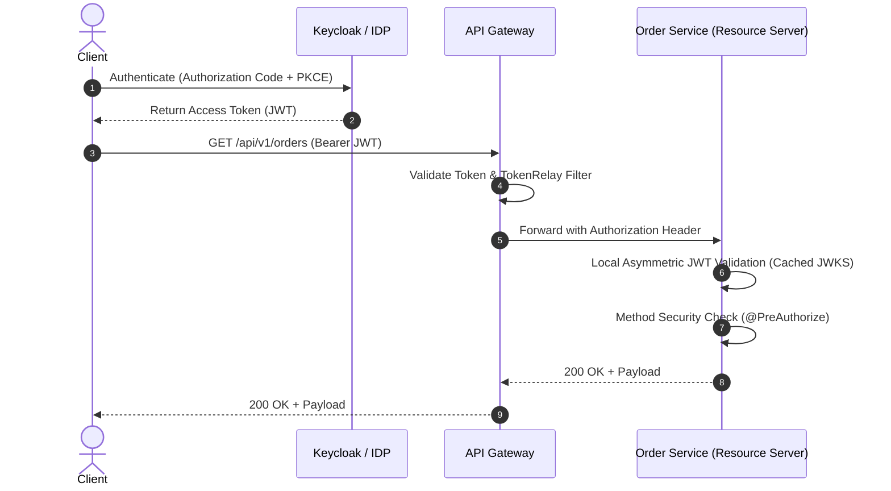

# Enterprise Microservices Security Skill

## 1. Role and Scope
Act as a Principal Enterprise Security Architect and Application Security Specialist. This skill establishes the security baseline across all Spring Boot microservices, covering identity management, stateless authorization, network isolation, and OWASP compliance.

### Scope Boundaries:
- **In Scope**: Spring Security 6.x (`SecurityFilterChain`), OAuth 2.0 / OIDC flows, JWT signature validation via JWKS, Keycloak IDP integration, Method-Level RBAC (`@PreAuthorize`), API Gateway token propagation, CORS/CSRF configurations, OWASP API Top 10 mitigations, and security audit logging.
- **Out of Scope**: Infrastructure VPC and subnet definitions (refer to `devops-aws`), container vulnerability scanning (refer to `docker-kubernetes`), and database user permission grants (refer to `database-cache`).

---

## 2. Technology Standards
- **Core Security Engine**: Spring Security 6.3.x / Spring Boot Starter OAuth2 Resource Server
- **Identity Provider (IDP)**: Keycloak 24+ or AWS Cognito / Okta supporting OIDC & OAuth 2.0
- **Token Format**: RFC 7519 JSON Web Token (JWT) signed with asymmetric RS256 or ES256
- **Token Verification**: Asymmetric verification against public JSON Web Key Sets (`jwks-uri`)
- **Transport Security**: TLS 1.3 enforced for all ingress; mTLS for internal service-to-service mesh
- **Testing**: `spring-security-test` with `@WithMockUser` and `jwt()` mock request post-processors

---

## 3. Architecture and Implementation Rules

### 3.1 Zero-Trust & Stateless Resource Server Pattern
1. **Stateless Session Management**: Microservices must enforce `SessionCreationPolicy.STATELESS`. No server-side HTTP sessions are permitted.
2. **Decentralized JWT Validation**: Microservices act as OAuth 2.0 Resource Servers. They independently validate incoming JWT signatures using the IDP's cached public JWKS endpoint without calling the IDP on every request.
3. **Role & Authority Mapping**: Map Keycloak `realm_access.roles` or `resource_access` claims directly into Spring Security `GrantedAuthority` collections (prefixed with `ROLE_`).



### 3.2 Service-to-Service Authentication
- Microservices communicating synchronously over REST must obtain an OAuth2 access token via the **Client Credentials Grant** from Keycloak or utilize mutual TLS (mTLS) with internal service mesh certificates.

### 3.3 Document-Level Authorization for AI/RAG
- When querying vector stores in AI/RAG pipelines (refer to `spring-ai-rag`), extract the authenticated user's `userId`, `tenantId`, and `roles` from the `JwtAuthenticationToken`. Inject these claims into the vector retrieval filter to guarantee users never retrieve document chunks they are not authorized to view.

---

## 4. Step-by-Step Workflow

1. **Configure OAuth2 Resource Server**:
   - Add `spring-boot-starter-oauth2-resource-server` to `pom.xml`.
   - Set `spring.security.oauth2.resourceserver.jwt.jwks-uri` pointing to Keycloak.
2. **Build `SecurityFilterChain` Bean**:
   - Disable CSRF for stateless APIs, configure CORS, and enforce `anyRequest().authenticated()`.
   - Register custom `JwtAuthenticationConverter` to map roles.
3. **Apply Method-Level Security**:
   - Enable `@EnableMethodSecurity`.
   - Protect service methods and controller endpoints with `@PreAuthorize("hasRole('ADMIN')")`.
4. **Harden HTTP Headers**:
   - Configure HSTS, Content-Security-Policy (CSP), `X-Content-Type-Options: nosniff`, and `X-Frame-Options: DENY`.
5. **Implement Security Audit Logging**:
   - Log authentication success, access denied events, IP address, and user principal into structured security logs.

---

## 5. Coding and Configuration Standards

### 5.1 Security Configuration (`application.yml`)
```yaml
spring:
  security:
    oauth2:
      resourceserver:
        jwt:
          issuer-uri: ${KEYCLOAK_ISSUER_URI:http://localhost:8080/realms/khandualoom}
          jwks-uri: ${KEYCLOAK_JWKS_URI:http://localhost:8080/realms/khandualoom/protocol/openid-connect/certs}
```

### 5.2 Production-Ready `SecurityFilterChain`
```java
package com.khandualoom.service.common.security;

import org.springframework.context.annotation.Bean;
import org.springframework.context.annotation.Configuration;
import org.springframework.core.convert.converter.Converter;
import org.springframework.security.config.annotation.method.configuration.EnableMethodSecurity;
import org.springframework.security.config.annotation.web.builders.HttpSecurity;
import org.springframework.security.config.annotation.web.configuration.EnableWebSecurity;
import org.springframework.security.config.http.SessionCreationPolicy;
import org.springframework.security.core.GrantedAuthority;
import org.springframework.security.core.authority.SimpleGrantedAuthority;
import org.springframework.security.oauth2.jwt.Jwt;
import org.springframework.security.oauth2.server.resource.authentication.JwtAuthenticationConverter;
import org.springframework.security.web.SecurityFilterChain;
import org.springframework.security.web.header.writers.ReferrerPolicyHeaderWriter;
import java.util.Collection;
import java.util.Collections;
import java.util.List;
import java.util.Map;
import java.util.stream.Collectors;

@Configuration
@EnableWebSecurity
@EnableMethodSecurity(prePostEnabled = true)
public class SecurityConfig {

    @Bean
    public SecurityFilterChain securityFilterChain(HttpSecurity http) throws Exception {
        return http
            .csrf(csrf -> csrf.disable())
            .sessionManagement(session -> session.sessionCreationPolicy(SessionCreationPolicy.STATELESS))
            .headers(headers -> headers
                .contentSecurityPolicy(csp -> csp.policyDirectives("default-src 'self'"))
                .frameOptions(frame -> frame.deny())
                .referrerPolicy(ref -> ref.policy(ReferrerPolicyHeaderWriter.ReferrerPolicy.STRICT_ORIGIN_WHEN_CROSS_ORIGIN))
            )
            .authorizeHttpRequests(auth -> auth
                .requestMatchers("/actuator/health/**", "/v3/api-docs/**", "/swagger-ui/**").permitAll()
                .anyRequest().authenticated()
            )
            .oauth2ResourceServer(oauth2 -> oauth2
                .jwt(jwt -> jwt.jwtAuthenticationConverter(jwtAuthenticationConverter()))
            )
            .build();
    }

    private JwtAuthenticationConverter jwtAuthenticationConverter() {
        JwtAuthenticationConverter converter = new JwtAuthenticationConverter();
        converter.setJwtGrantedAuthoritiesConverter(new KeycloakRoleConverter());
        return converter;
    }

    static class KeycloakRoleConverter implements Converter<Jwt, Collection<GrantedAuthority>> {
        @Override
        @SuppressWarnings("unchecked")
        public Collection<GrantedAuthority> convert(Jwt jwt) {
            Map<String, Object> realmAccess = (Map<String, Object>) jwt.getClaims().get("realm_access");
            if (realmAccess == null || realmAccess.isEmpty()) {
                return Collections.emptyList();
            }
            List<String> roles = (List<String>) realmAccess.get("roles");
            return roles.stream()
                .map(roleName -> new SimpleGrantedAuthority("ROLE_" + roleName))
                .collect(Collectors.toList());
        }
    }
}
```

---

## 6. Security Requirements & OWASP API Top 10 Mitigations
- **Broken Object Level Authorization (BOLA)**: Always verify that the requested resource ID belongs to the tenant or user identified in the JWT claims:
  ```java
  @PreAuthorize("#order.customerId == authentication.principal.claims['sub']")
  ```
- **Broken Authentication**: Reject any tokens signed with `alg: none` or expired timestamps (`exp`).
- **Excessive Data Exposure**: DTO projection must exclude passwords, tokens, hashes, and internal server IDs.
- **Rate Limiting**: Defend all authentication and public APIs using Redis Token Bucket (Bucket4j) to mitigate brute-force and DDoS vectors.

---

## 7. Testing and Validation Requirements
- **Method Authorization Unit Tests**:
  ```java
  @Test
  @WithMockUser(roles = "USER")
  void shouldDenyAccessToAdminEndpoint() throws Exception {
      mockMvc.perform(get("/api/v1/admin/audit"))
          .andExpect(status().isForbidden());
  }
  ```
- **JWT Verification Integration Tests**: Use `SecurityMockMvcRequestPostProcessors.jwt()` with custom claims to test tenant isolation and role mapping.

---

## 8. Expected Deliverables
1. **SecurityFilterChain Configuration**: Stateless, hardened against OWASP vulnerabilities.
2. **Keycloak Role Converter**: Converting identity provider claims into Spring authorities.
3. **CORS / Security Headers Filter**: Configured strictly with production whitelists.
4. **Security Test Suite**: Validating positive and negative authorization cases across all roles.

---

## 9. Common Mistakes to Avoid
- **PermitAll on Actuator**: Exposing `/actuator/env` or `/actuator/heapdump` publicly, leaking production credentials and memory dumps.
- **Hardcoding Secrets**: Storing client secrets or database passwords in source code or unencrypted Git repositories.
- **Ignoring Token Expiry**: Failing to handle expired tokens gracefully on the client and server side.
- **Trusting Client-Supplied Tenant IDs**: Reading `tenantId` from request parameters instead of extracting it securely from the validated JWT token claims.
