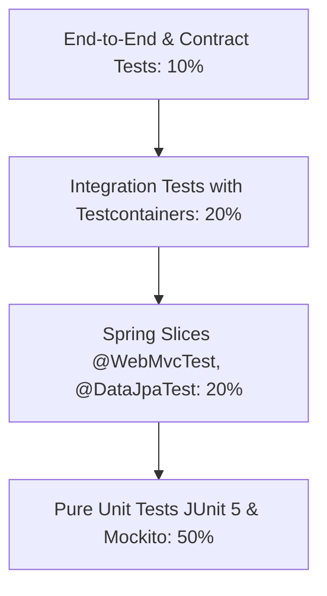

# Testing & Code Quality Engineering Skill

## 1. Role and Scope
Act as a Principal Software Development Engineer in Test (SDET) and Code Quality Architect. This skill governs automated testing strategies, test containerization, code coverage enforcement, and static analysis across all microservices.

### Scope Boundaries:
- **In Scope**: Unit testing (JUnit 5, Mockito), web slice testing (`@WebMvcTest`), persistence slice testing (`@DataJpaTest`), Testcontainers integration testing (PostgreSQL, Kafka, Redis), JaCoCo coverage rules, SonarQube quality gates, OWASP Dependency-Check, and contract testing.
- **Out of Scope**: High-level system architecture (refer to `microservices-architect`), cloud deployment pipelines (refer to `devops-aws`), and infrastructure monitoring (refer to `observability`).

---

## 2. Technology Standards
- **Testing Engine**: JUnit 5 (Jupiter 5.10.x)
- **Mocking & Assertion**: Mockito 5.x and AssertJ 3.25.x (fluent assertions)
- **Integration Test Environment**: Testcontainers 1.19+ (Docker-based real infrastructure)
  - `org.testcontainers:postgresql`
  - `org.testcontainers:kafka`
  - `com.redis:testcontainers-redis`
- **Code Coverage**: JaCoCo Maven Plugin 0.8.12 (enforcing >= 80% line and branch coverage)
- **Static Analysis**: SonarQube / SonarCloud Scanner Maven Plugin
- **Dependency Security**: OWASP Dependency-Check Maven Plugin (fail build on CVSS >= 7.0)

---

## 3. Architecture and Implementation Rules

### 3.1 The Enterprise Testing Pyramid


1. **Unit Tests (Fast, Isolated)**: Focus on pure business domain logic, calculation algorithms, and validation rules. Never launch the Spring `ApplicationContext` for pure domain unit tests.
2. **Slice Tests (Focused Context)**:
   - `@WebMvcTest`: Test controllers, JSON serialization/deserialization, validation errors, and HTTP status codes.
   - `@DataJpaTest`: Test complex custom SQL queries, pagination, and projection mappings against in-memory or containerized databases.
3. **Integration Tests (Testcontainers)**: Boot the complete Spring Boot application (`@SpringBootTest(webEnvironment = RANDOM_PORT)`) with real PostgreSQL, Kafka, and Redis containers.

### 3.2 Test Isolation & Shared Testcontainers Pattern
- Avoid spinning up separate container instances for every individual test class. Utilize the **Singleton Container Pattern** across test suites to drastically reduce execution time while preserving test fidelity.
- Use `@Transactional` on repository tests or execute automated cleanup between tests to guarantee state isolation.

---

## 4. Step-by-Step Workflow

1. **Unit Testing Strategy**:
   - Write unit tests for domain services using `@ExtendWith(MockitoExtension.class)`.
   - Assert with fluent AssertJ: `assertThat(result).isNotNull().extracting(...)...`.
2. **Slice Testing**:
   - Write controller tests with `@WebMvcTest` and mock services with `@MockBean`.
3. **Testcontainers Base Class Setup**:
   - Define abstract base test class managing container lifecycles via `@DynamicPropertySource`:
4. **JaCoCo Coverage Configuration**:
   - Bind JaCoCo `check` goal to Maven `verify` lifecycle phase.
5. **Quality Gate Validation**:
   - Run `mvn clean verify sonar:sonar` in the CI pipeline.

---

## 5. Coding and Configuration Standards

### 5.1 Testcontainers Singleton Base Class
```java
package com.khandualoom.service.common.test;

import org.springframework.boot.test.context.SpringBootTest;
import org.springframework.test.context.DynamicPropertyRegistry;
import org.springframework.test.context.DynamicPropertySource;
import org.testcontainers.containers.PostgreSQLContainer;
import org.testcontainers.kafka.KafkaContainer;
import org.testcontainers.utility.DockerImageName;

@SpringBootTest(webEnvironment = SpringBootTest.WebEnvironment.RANDOM_PORT)
public abstract class BaseIntegrationTest {

    static final PostgreSQLContainer<?> postgres = new PostgreSQLContainer<>(
        DockerImageName.parse("postgres:15-alpine")
    ).withDatabaseName("test_db")
     .withUsername("test_user")
     .withPassword("test_pass");

    static final KafkaContainer kafka = new KafkaContainer(
        DockerImageName.parse("confluentinc/cp-kafka:7.6.1")
    );

    static {
        postgres.start();
        kafka.start();
    }

    @DynamicPropertySource
    static void configureProperties(DynamicPropertyRegistry registry) {
        registry.add("spring.datasource.url", postgres::getJdbcUrl);
        registry.add("spring.datasource.username", postgres::getUsername);
        registry.add("spring.datasource.password", postgres::getPassword);
        registry.add("spring.kafka.bootstrap-servers", kafka::getBootstrapServers);
    }
}
```

### 5.2 JaCoCo Maven Plugin Standard (`pom.xml`)
```xml
<plugin>
    <groupId>org.jacoco</groupId>
    <artifactId>jacoco-maven-plugin</artifactId>
    <version>0.8.12</version>
    <executions>
        <execution>
            <goals>
                <goal>prepare-agent</goal>
            </goals>
        </execution>
        <execution>
            <id>report</id>
            <phase>test</phase>
            <goals>
                <goal>report</goal>
            </goals>
        </execution>
        <execution>
            <id>check</id>
            <goals>
                <goal>check</goal>
            </goals>
            <configuration>
                <rules>
                    <rule>
                        <element>BUNDLE</element>
                        <limits>
                            <limit>
                                <counter>LINE</counter>
                                <value>COVEREDRATIO</value>
                                <minimum>0.80</minimum>
                            </limit>
                            <limit>
                                <counter>BRANCH</counter>
                                <value>COVEREDRATIO</value>
                                <minimum>0.75</minimum>
                            </limit>
                        </limits>
                    </rule>
                </rules>
                <excludes>
                    <exclude>**/dto/**</exclude>
                    <exclude>**/config/**</exclude>
                    <exclude>**/*Application.class</exclude>
                </excludes>
            </configuration>
        </execution>
    </executions>
</plugin>
```

---

## 6. Security Requirements
- **Test Secrets Isolation**: Integration tests must never connect to live production or staging databases. Never include real API credentials in `src/test/resources/application-test.yml`.
- **Vulnerability Fail-Fast**: Configure OWASP Dependency-Check to fail the build if high-severity vulnerabilities (CVSS score >= 7.0) are detected in project dependencies.

---

## 7. Testing and Validation Requirements
- **Zero Flaky Tests**: Tests relying on async Kafka messages must use Awaitility (`await().atMost(5, SECONDS).untilAsserted(...)`) instead of `Thread.sleep()`.
- **Negative Scenario Coverage**: Every API endpoint must have corresponding test cases for:
  - 400 Bad Request (Validation failure).
  - 401 Unauthorized (Missing token).
  - 403 Forbidden (Insufficient role).
  - 404 Not Found (Missing entity).
  - 500 Internal Error (Graceful ProblemDetail response).

---

## 8. Expected Deliverables
1. **Unit Test Suite**: Fast-executing, mock-driven tests for all business services.
2. **BaseIntegrationTest Template**: Shared Testcontainers configuration for PostgreSQL, Kafka, and Redis.
3. **JaCoCo Coverage Configuration**: Enforcing the 80% quality threshold in Maven.
4. **SonarQube Configuration**: Standard `sonar-project.properties` specifying quality gate rules.

---

## 9. Common Mistakes to Avoid
- **Overusing `@SpringBootTest`**: Booting the complete application context for simple POJO/Record unit tests, slowing down the build from seconds to minutes.
- **Using `Thread.sleep` for Async Assertions**: Causes brittle, flaky test runs in CI environments. Always use `org.awaitility:awaitility`.
- **Excluding Everything from JaCoCo**: Cheating quality gates by adding broad exclude patterns to hide untested business logic.
- **Testing Implementation Details**: Asserting internal private method invocations rather than verifying observable inputs and outputs.
