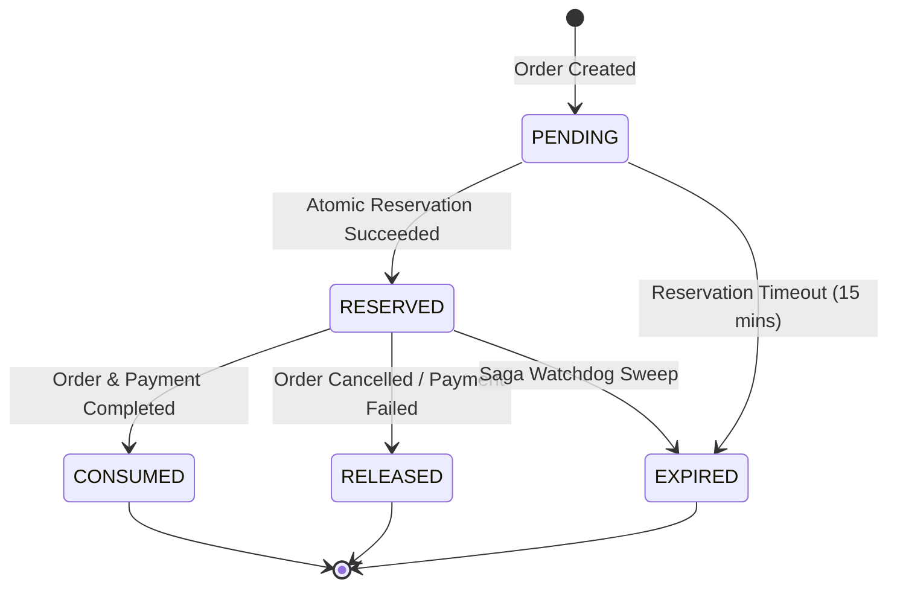

# Khandua Looms — Inventory Concurrency & Reservation Lifecycle

**Architecture Pattern:** Atomic Conditional Concurrency Control & State-Enforced Reservations  
**Target Service:** `inventory-service`  
**Collaborating Services:** `order-service`, `payment-service`  
**Date:** November 2026  

---

## 1. Architectural Overview

During high-concurrency flash sales (such as festive Sambalpuri and Khandua saree launches), thousands of concurrent shoppers may attempt to purchase limited inventory items simultaneously. 

Standard ORM approaches relying on read-modify-write (`findById()`, `setAvailable()`, `save()`) result in either:
1. **Lost Updates & Overselling**: Concurrent transactions read the same available stock, both decrement it, and write back corrupt values, allowing available inventory to drop below zero.
2. **Pessimistic Locking Bottlenecks**: `SELECT ... FOR UPDATE` serializes all transactions, causing database connection pool exhaustion and HTTP 504 gateway timeouts.

To guarantee zero overselling without latency bottlenecks, Khandua Looms implements:
1. **Atomic Conditional Concurrency Control**: Stock reservations and releases execute in a single SQL operation with atomic predicate checking.
2. **Formal Reservation State Machine**: Tracking stock reservations through `ReservationStatus` (`PENDING, RESERVED, CONSUMED, RELEASED, EXPIRED`).
3. **Transactional Outbox Event Dispatch**: Emitting `inventory.reserved` or `inventory.reservation-failed` inside the local database transaction.

---

## 2. Atomic Conditional Concurrency Control

Instead of locking rows in Java, the database engine enforces atomicity at the row level using conditional predicates:

```sql
-- Atomic Stock Reservation (Executed by SpringDataInventoryRepository.atomicReserveStock)
UPDATE inventory_items
SET available_stock = available_stock - :quantity,
    reserved_stock  = reserved_stock  + :quantity,
    version         = version + 1,
    updated_at      = CURRENT_TIMESTAMP
WHERE product_id = :productId
  AND available_stock >= :quantity;
```

### 2.1 Concurrency Semantics

| Scenario | Database Outcome | Application Result |
| :--- | :--- | :--- |
| **Sufficient Stock** (`available_stock >= quantity`) | Exactly 1 row updated. `UPDATE` returns count `1`. | Reservation succeeds. Outbox event `inventory.reserved` created. |
| **Insufficient Stock** (`available_stock < quantity`) | Predicate fails. `UPDATE` returns count `0`. | Throws `InsufficientStockException`. Outbox event `inventory.reservation-failed` created. |
| **Concurrent Flash-Sale (10 units, 50 requests)** | Exactly 10 updates match the predicate; 40 return `0`. | Zero overselling guaranteed; remaining 40 fail fast without lock contention. |

### 2.2 Atomic Release & Fulfillment Operations

```sql
-- Atomic Stock Release (Compensation when Order/Payment Fails)
UPDATE inventory_items
SET available_stock = available_stock + :quantity,
    reserved_stock  = reserved_stock  - :quantity,
    version         = version + 1
WHERE product_id = :productId
  AND reserved_stock >= :quantity;

-- Atomic Stock Fulfillment (When Order & Payment Complete Successfully)
UPDATE inventory_items
SET reserved_stock = reserved_stock - :quantity,
    total_stock    = total_stock    - :quantity,
    version        = version + 1
WHERE product_id = :productId
  AND reserved_stock >= :quantity;
```

---

## 3. Stock Reservation State Machine



### 3.1 State Transitions

| Current State | Target State | Permitted? | Business Context |
| :--- | :--- | :---: | :--- |
| `PENDING` | `RESERVED` | **YES** | Stock successfully held for customer checkout. |
| `RESERVED` | `CONSUMED` | **YES** | Payment verified; inventory permanently deducted from warehouse. |
| `RESERVED` | `RELEASED` | **YES** | Payment failed or order cancelled; stock returned to available pool. |
| `RESERVED` | `EXPIRED` | **YES** | 15-minute checkout window lapsed without payment. |
| `CONSUMED` | `RELEASED` | **NO** | Terminal state: Fulfilled items cannot be released via reservation. |
| `RELEASED` | `CONSUMED` | **NO** | Terminal state. |

---

## 4. Deduplication & Idempotent Ingestion

To prevent double-reserving inventory when Kafka redelivers `order.created` events:
1. **Unique Index**: `CREATE UNIQUE INDEX idx_stock_res_order_product ON stock_reservations(order_id, product_id);`
2. **Idempotent Ingestion Template**: `IdempotentConsumerTemplate` checks `processed_events` using composite key `(order_created_event_id, "inventory-service-group")`.
3. If duplicate arrives, the consumer logs `Duplicate event detected, skipping execution` and immediately acknowledges the message without touching inventory balances.

---

## 5. Source Code Traceability

| Component | File Path | Primary Function |
| :--- | :--- | :--- |
| **Domain State Machine** | `inventory-service/.../domain/model/ReservationStatus.java` | Enum enforcing valid reservation transitions. |
| **Domain Reservation** | `inventory-service/.../domain/model/StockReservation.java` | Aggregate root tracking quantity, orderId, expiry time, and status. |
| **Atomic Repository** | `inventory-service/.../persistence/repository/SpringDataInventoryRepository.java` | Executes `@Modifying` conditional update queries. |
| **Application Service** | `inventory-service/.../application/service/InventoryService.java` | Coordinates atomic updates, reservation records, and outbox writes. |
| **Outbox Publisher** | `inventory-service/.../messaging/InventoryOutboxPublisherService.java` | Dispatches `inventory.reserved` and `inventory.reservation-failed`. |
| **Flyway Schema** | `inventory-service/.../db/migration/V2__inventory_outbox_and_constraints.sql` | Table DDL, unique indexes, and outbox schemas. |
| **Unit Tests** | `inventory-service/src/test/.../InventoryItemTest.java` & `ReservationStatusTest.java` | Concurrency and state transition test cases. |
