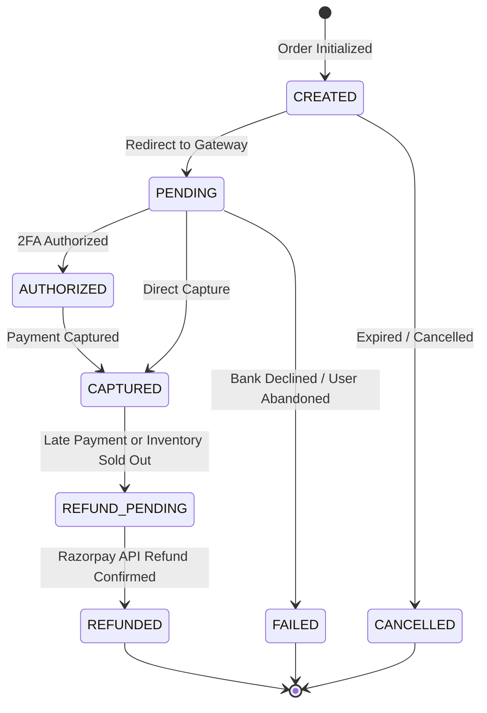
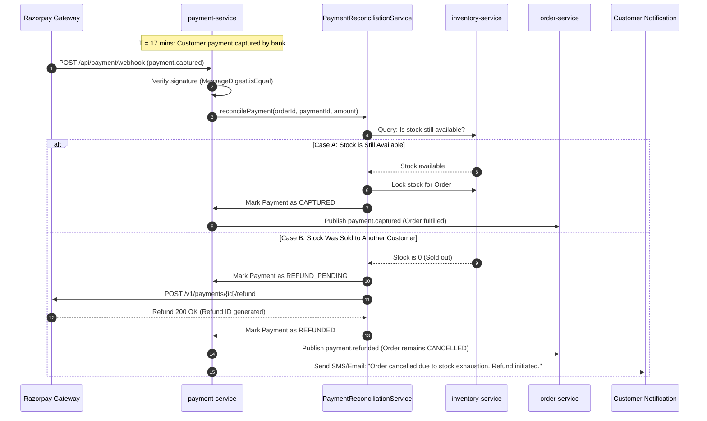

# Khandua Looms — Payment Architecture & Reconciliation Specification

**Architecture Pattern:** Unified Observation Pipeline, Durable State Machine & Automated Reconciliation  
**Target Service:** `payment-service`  
**Collaborating Services:** `order-service`, `inventory-service`, `notification-service`, `audit-service`  
**External Integration:** Razorpay Payment Gateway  
**Date:** November 2026  

---

## 1. Architectural Overview

The payment infrastructure of an enterprise e-commerce platform must satisfy three non-negotiable criteria:
1. **Mathematical Timing Attack Resistance**: Cryptographic signatures from payment gateways must be evaluated in constant time.
2. **Dual-Path Ingestion Reconciliation**: Both synchronous frontend redirect confirmation (`/api/payment/verify`) and asynchronous server-to-server webhook notifications (`/api/payment/webhook`) must converge into an idempotent observation pipeline without racing or overwriting terminal states.
3. **Orphaned Payment Resolution**: When a network delay or bank processing latency results in payment capture after the 15-minute stock reservation window has expired, the system must deterministically decide whether to fulfill the order or execute an automated refund.

---

## 2. Unified Observation Pipeline

To eliminate race conditions between the customer's browser redirecting to `/api/payment/verify` and Razorpay asynchronously pushing a webhook event to `/api/payment/webhook`, both flows route through `PaymentApplicationService.recordPaymentObservation()`.

```mermaid
flowchart TD
    subgraph Ingestion
        A[Customer Browser: POST /api/payment/verify] --> C[PaymentApplicationService.recordPaymentObservation]
        B[Razorpay Webhook: POST /api/payment/webhook] --> C
    end

    subgraph Security & Verification
        C --> D{Source Type?}
        D -- REST Checkout --> E[Compute HMAC-SHA256: orderId + '|' + paymentId]
        D -- Webhook Event --> F[Compute HMAC-SHA256: Raw JSON Payload]
        E --> G[MessageDigest.isEqual Constant-Time Verification]
        F --> G
    end

    subgraph Deduplication & Execution
        G -- Invalid Signature --> H[Reject with Security Alert / HTTP 400]
        G -- Valid Signature --> I[Acquire Row Lock / Check Idempotency]
        I -- Already CAPTURED --> J[Ignore Duplicate Observation]
        I -- New or In-Progress --> K[Update Payment to CAPTURED]
        K --> L[Write Outbox Event: payment.captured]
    end
```

### 2.1 Constant-Time HMAC Signature Verification

```java
// Prevents side-channel timing attacks
public boolean verifySignature(String orderId, String paymentId, String signature) {
    String payload = orderId + "|" + paymentId;
    String generatedSignature = calculateHmacSha256(payload, keySecret);
    return MessageDigest.isEqual(
        generatedSignature.getBytes(StandardCharsets.UTF_8),
        signature.getBytes(StandardCharsets.UTF_8)
    );
}
```

---

## 3. Payment State Machine

The payment lifecycle is governed by the `PaymentStatus` domain enum with enforced state transitions:



### 3.1 State Transition Validation Matrix

| Current State | Target State | Permitted? | Business Context |
| :--- | :--- | :---: | :--- |
| `CREATED` | `PENDING` | **YES** | User opens Razorpay checkout modal. |
| `PENDING` | `CAPTURED` | **YES** | Payment verified via REST or webhook. |
| `PENDING` | `FAILED` | **YES** | Gateway reports card declined or expired OTP. |
| `CAPTURED` | `REFUND_PENDING` | **YES** | Inventory reservation expired; stock unavailable. |
| `REFUND_PENDING` | `REFUNDED` | **YES** | Razorpay refund API execution confirmed. |
| `CAPTURED` | `FAILED` | **NO** | Terminal state protection: late failure webhook ignored. |
| `REFUNDED` | `CAPTURED` | **NO** | Terminal state protection. |

---

## 4. Late Payment & Inventory Reconciliation Flow

A critical race condition occurs when a payment succeeds after the 15-minute stock hold has expired:



---

## 5. Source Code Traceability

| Component | File Path | Primary Function |
| :--- | :--- | :--- |
| **Domain State Machine** | `payment-service/.../domain/model/PaymentStatus.java` | Enum enforcing state transition guards. |
| **Observation Service** | `payment-service/.../application/service/PaymentApplicationService.java` | Unified entry point for REST and Webhook observations. |
| **Reconciliation Service**| `payment-service/.../application/service/PaymentReconciliationService.java`| Resolves late payments, re-checks stock, and issues automated refunds. |
| **Razorpay Adapter** | `payment-service/.../infrastructure/razorpay/RazorpayClientService.java` | Constant-time HMAC calculation and refund API invocation. |
| **Outbox Publisher** | `payment-service/.../messaging/PaymentOutboxPublisherService.java` | Publishes `payment.captured`, `payment.failed`, `payments.refund-processed`. |
| **Flyway Schema** | `payment-service/.../db/migration/V2__payment_outbox_and_constraints.sql` | Unique partial indexes on `razorpay_payment_id` and `webhook_event_id`. |
| **Unit Tests** | `payment-service/src/test/.../PaymentStatusTest.java` & `PaymentReconciliationServiceTest.java` | Automated validation of transitions, recovery, and refunds. |
