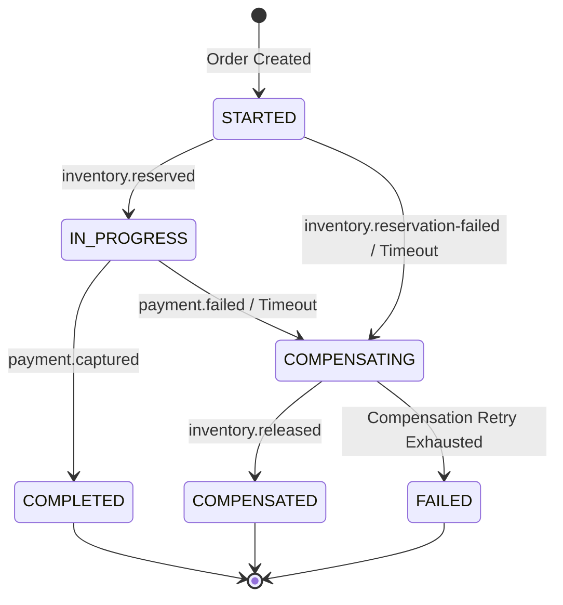
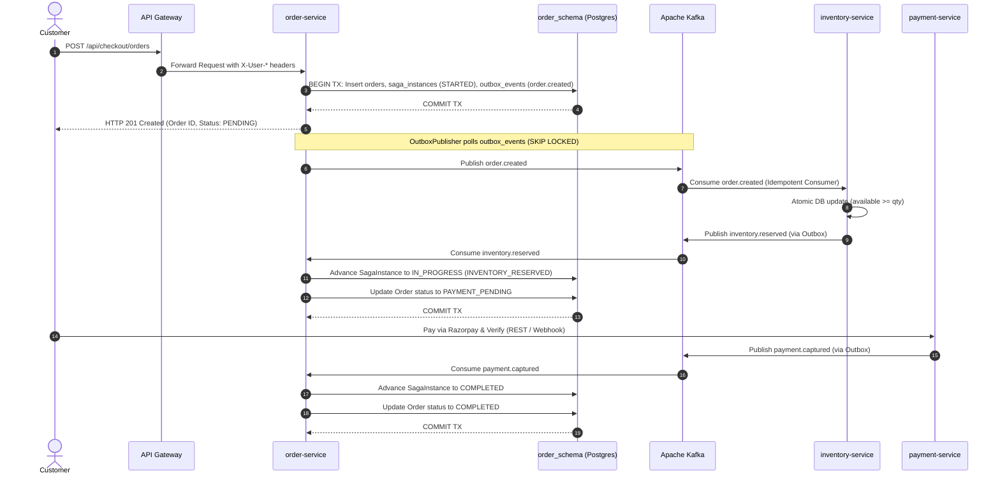
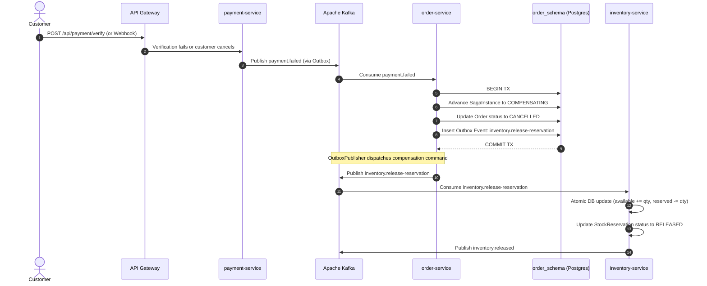
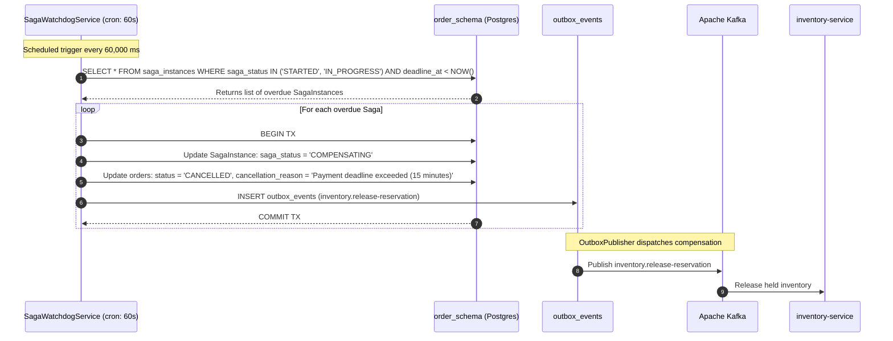

# Khandua Looms — Distributed Order Saga Workflow Specification

**Architecture Pattern:** Orchestrated Saga with Transactional Outbox & Scheduled Watchdog  
**Target Service:** `order-service`  
**Collaborating Services:** `inventory-service`, `payment-service`, `notification-service`, `audit-service`  
**Date:** November 2026  

---

## 1. Architectural Overview

In a distributed microservices ecosystem with isolated databases, a customer order spanning inventory reservation and payment processing cannot rely on two-phase commit (2PC) or distributed ACID transactions due to latency, lock contention, and availability trade-offs (Brewer's CAP Theorem). 

Khandua Looms implements an **Orchestrated Saga** backed by:
1. **Durable Saga State Machine (`SagaInstance`)**: Persisted in PostgreSQL (`order_schema.saga_instances`) with optimistic locking (`@Version`).
2. **Transactional Outbox**: All forward and compensating commands are written to `outbox_events` within the local ACID boundary.
3. **At-Least-Once Consumer Idempotency**: Handled by `IdempotentConsumerTemplate` using composite key `(event_id, consumer_group)`.
4. **Saga Watchdog Worker**: A background scheduler (`@Scheduled(fixedDelay = 60000)`) detecting stalled workflows past their 15-minute deadline (`deadline_at < NOW()`).

---

## 2. Saga State Machine & Step Transitions

### 2.1 State Definitions

| Saga Status | Step | Description | Next Allowed State |
| :--- | :--- | :--- | :--- |
| `STARTED` | `ORDER_CREATED` | Order entity created with `PENDING` status; outbox event emitted to reserve inventory. | `IN_PROGRESS`, `FAILED` |
| `IN_PROGRESS` | `INVENTORY_RESERVED` | `inventory.reserved` event received; outbox event emitted to initiate Razorpay payment. | `COMPLETED`, `COMPENSATING` |
| `COMPLETED` | `PAYMENT_CAPTURED` | `payment.captured` event received; order status transitioned to `COMPLETED`. | Terminal State |
| `COMPENSATING` | `COMPENSATING_INVENTORY` | `payment.failed` or watchdog timeout encountered; outbox event emitted to release reservation. | `COMPENSATED`, `FAILED` |
| `COMPENSATED` | `COMPLETED` | Compensation verified; order marked `CANCELLED`. | Terminal State |
| `FAILED` | `COMPLETED` | Non-recoverable failure or terminal compensation failure. | Terminal State |

---

## 3. End-to-End Workflow Sequences

### 3.1 Happy Path Sequence (Successful Order & Payment)

---

### 3.2 Failure & Compensation Sequence (Payment Failed)

---

### 3.3 Overdue Saga Recovery Sequence (Saga Watchdog)

---

## 4. Source Code Traceability

| Component | File Path | Primary Function |
| :--- | :--- | :--- |
| **Saga Entity** | `order-service/src/main/java/.../model/SagaInstance.java` | Durable state entity with `@Version` optimistic locking and state validation. |
| **Saga Repository** | `order-service/src/main/java/.../repository/SagaInstanceRepository.java` | Custom query `findOverdueSagas(@Param("now") Instant now)`. |
| **Saga Orchestrator** | `order-service/src/main/java/.../service/OrderSagaOrchestrator.java` | Event listener coordinating transitions and compensation dispatches. |
| **Saga Watchdog** | `order-service/src/main/java/.../service/SagaWatchdogService.java` | Background worker recovering stalled workflows and releasing inventory. |
| **Flyway Schema** | `order-service/src/main/resources/db/migration/V4__saga_instances_and_outbox_upgrade.sql` | DDL table definitions and indexes on `(saga_status, deadline_at)`. |
| **Saga Unit Tests** | `order-service/src/test/java/.../SagaInstanceTest.java` & `SagaWatchdogServiceTest.java` | Automated tests verifying state transitions and timeout sweep. |
