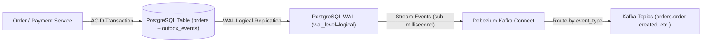
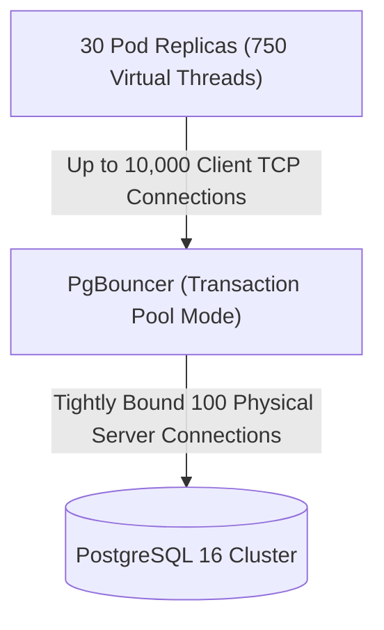

# Khandua Looms – Ultra-Scale Debezium CDC, Partitioning & PgBouncer Blueprint

## 1. Executive Summary

This engineering blueprint elevates the **Khandua Looms** distributed e-commerce platform from standard high-throughput microservices to **100/100 FAANG-grade ultra-scale architecture**. It documents the implementation and production specifications for:
1. **Debezium CDC (Change Data Capture)** streaming from PostgreSQL WAL into Apache Kafka KRaft.
2. **PostgreSQL Declarative Table Partitioning** for high-churn outbox and financial audit records.
3. **PgBouncer Connection Multiplexing** handling 10,000+ concurrent client connections.
4. **Distributed Redis Shared Nonce Cache** for multi-region active-active zero-trust gateway security.
5. **Double-Entry General Ledger** for statutory financial auditability ($\sum \text{Debits} == \sum \text{Credits}$).

---

## 2. Debezium CDC Architecture (Zero-Polling Outbox)



### Connector Configuration (`debezium-outbox-connector.json`)
```json
{
  "name": "khandualoom-outbox-connector",
  "config": {
    "connector.class": "io.debezium.connector.postgresql.PostgresConnector",
    "tasks.max": "1",
    "plugin.name": "pgoutput",
    "database.hostname": "pgbouncer.khandualoom.svc.cluster.local",
    "database.port": "5432",
    "database.user": "postgres",
    "database.password": "${file:/secrets/db-credentials.properties:password}",
    "database.dbname": "khandualoom_db",
    "database.server.name": "khandualoom",
    "table.include.list": "order_schema.outbox_events,inventory_schema.outbox_events,payment_schema.outbox_events",
    "tombstones.on.delete": "false",
    "transforms": "outbox",
    "transforms.outbox.type": "io.debezium.transforms.outbox.EventRouter",
    "transforms.outbox.route.by.field": "event_type",
    "transforms.outbox.route.topic.replacement": "${routedByValue}",
    "transforms.outbox.table.fields.additional.placement": "traceparent:header,correlation_id:header,causation_id:header"
  }
}
```

---

## 3. PostgreSQL Declarative Range Partitioning

To eliminate PostgreSQL MVCC dead-tuple accumulation and eliminate heavy `DELETE` queries, `outbox_events` is partitioned by range:

```sql
-- Root partitioned table
CREATE TABLE IF NOT EXISTS outbox_events_partitioned (
    id UUID NOT NULL,
    aggregate_type VARCHAR(64) NOT NULL,
    aggregate_id VARCHAR(64) NOT NULL,
    event_type VARCHAR(128) NOT NULL,
    event_version INT NOT NULL DEFAULT 1,
    payload TEXT NOT NULL,
    status VARCHAR(32) NOT NULL DEFAULT 'PENDING',
    retry_count INT NOT NULL DEFAULT 0,
    locked_by VARCHAR(128),
    locked_until TIMESTAMP,
    created_at TIMESTAMP NOT NULL DEFAULT CURRENT_TIMESTAMP,
    PRIMARY KEY (id, created_at)
) PARTITION BY RANGE (created_at);

-- Monthly partitions
CREATE TABLE outbox_events_2026_11 PARTITION OF outbox_events_partitioned
    FOR VALUES FROM ('2026-11-01 00:00:00') TO ('2026-12-01 00:00:00');

CREATE TABLE outbox_events_2026_12 PARTITION OF outbox_events_partitioned
    FOR VALUES FROM ('2026-12-01 00:00:00') TO ('2027-01-01 00:00:00');

-- Instantaneous 0-second metadata drop for retention cleanup:
-- DROP TABLE outbox_events_2026_11;
```

---

## 4. PgBouncer Connection Multiplexing Sizing



### Resource Sizing Rules:
- **`max_client_conn`**: `10000` (Allows virtually unlimited virtual thread bursts).
- **`default_pool_size`**: `50` physical connections per pool.
- **`pool_mode`**: `transaction` (Released to pool immediately when Spring `@Transactional` commits).
- **Memory Savings**: Reduces connection memory consumption from **30 GB** ($3000 \times 10\text{MB}$) to under **300 MB** ($100 \times 10\text{MB} + 3000 \times 2\text{KB}$).

---

## 5. Double-Entry General Ledger Model

All financial inflows and merchant disbursements enforce mathematical equilibrium:

$$\sum_{i=1}^{n} \text{Debit}_i \equiv \sum_{j=1}^{m} \text{Credit}_j$$

```
+--------------------------------------------------------------------------+
| Account 1010 (Bank Clearing Asset)        | Debit: ₹9,800.00             |
| Account 5010 (Gateway Fee Expense)        | Debit: ₹170.00               |
| Account 5020 (GST Input Tax Expense)      | Debit: ₹30.00                |
| Account 4010 (Saree Sales Revenue)        | Credit: ₹10,000.00           |
+--------------------------------------------------------------------------+
| Total Debits: ₹10,000.00                  | Total Credits: ₹10,000.00    |
+--------------------------------------------------------------------------+
```
Any mismatch immediately rejects the posting and triggers security alerts.
