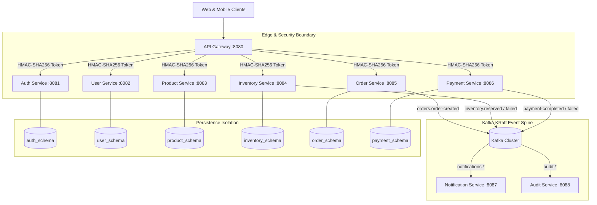
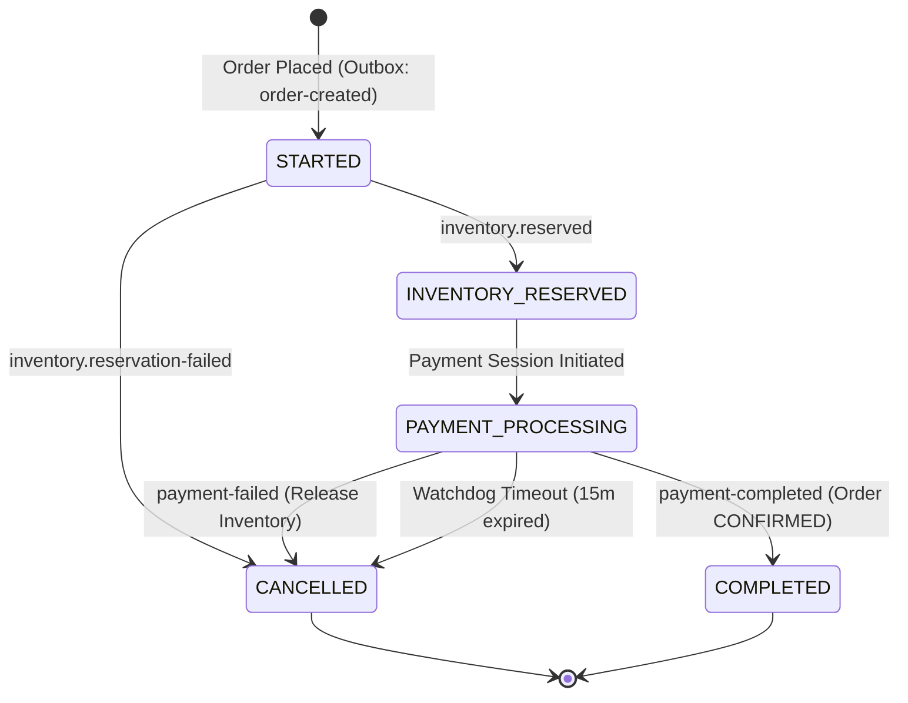
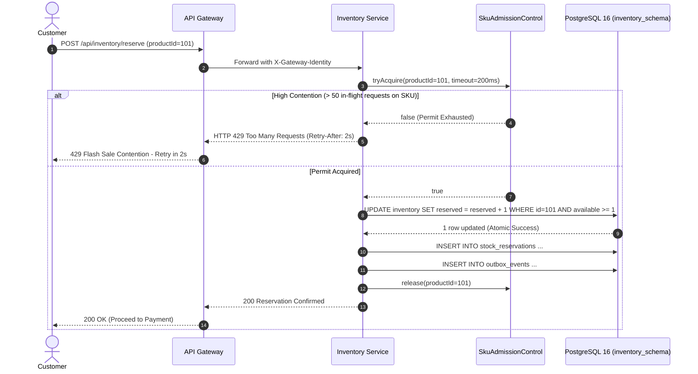
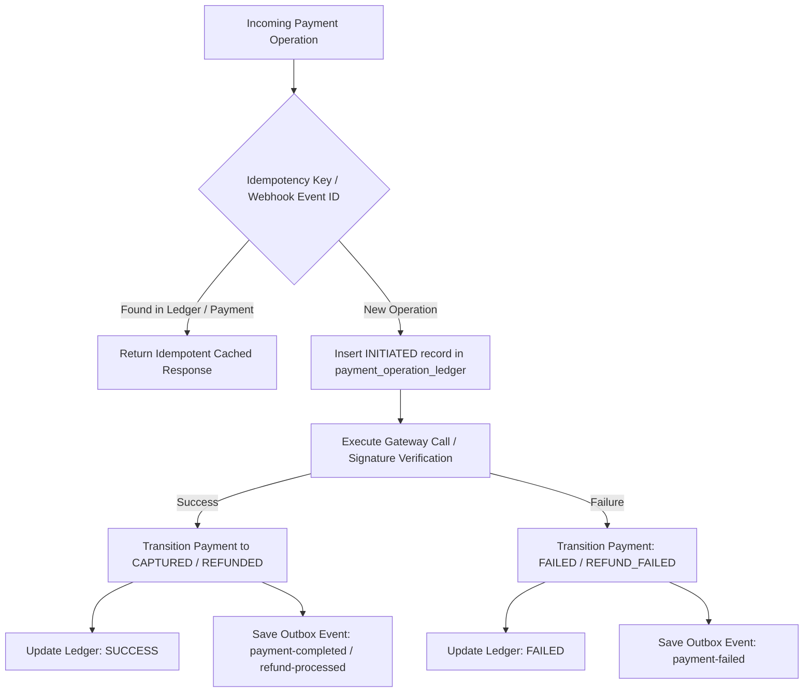

# Khandua Looms – Production Architecture Design

## Executive Summary

Khandua Looms is an enterprise, high-throughput e-commerce platform dedicated to handwoven sarees and textile heritage. This architecture specification outlines the production blueprint capable of processing **100,000+ daily orders**, sustaining **10,000 requests/second** during controlled flash-sale peaks, guaranteeing **strict zero-overselling** for rare handloom pieces, ensuring **dual-write proof payment processing**, and delivering a **99.99% availability SLA**.

---

## 1. System Topology & Service Boundaries

The platform operates on a 20-module Maven aggregator with 9 autonomous domain microservices, completely segregated by dedicated logical PostgreSQL schemas with zero cross-database SQL joins.

---

## 2. Distributed Transaction Architecture (Orchestrated Saga)

Distributed orders are coordinated through an **Orchestrated Saga Pattern** owned by the `order-service` with a persistent state machine and autonomous watchdog.

### Saga State Machine

### Race-Condition Arbitration & Late Payment Reconciliation
If a customer completes payment at the 16th minute while the background watchdog expired the Saga at the 15th minute:
1. `OrderSagaOrchestrator` detects that `order.status == CANCELLED`.
2. It prevents overwriting the order status and routes the event to `orders.late-payment-reconciliation`.
3. `PaymentReconciliationService` verifies stock availability:
   - If stock can be re-reserved, it restores the order cleanly.
   - If stock was claimed by another customer, it executes an automated Razorpay refund, logs the `REFUND_INITIATE` operation in `payment_operation_ledger`, and emits `payments.refund-processed`.

---

## 3. High-Concurrency Flash Sale Architecture (Zero Overselling)

Rare handloom sarees exist in finite quantities (frequently only 1 saree per SKU). To prevent row lock contention and HikariCP connection pool exhaustion under 10,000 req/s:

### Atomic Reservation Guarantees
- Single atomic SQL decrement: `UPDATE inventory_items SET available_stock = available_stock - :qty, reserved_stock = reserved_stock + :qty WHERE product_id = :id AND available_stock >= :qty`.
- State transitions on `stock_reservations` (`RESERVED -> CONSUMED` or `RESERVED -> RELEASED` or `RESERVED -> EXPIRED`) use atomic CAS updates (`UPDATE stock_reservations SET status = :target WHERE id = :id AND status = :expected`). If updated count == 0, no stock adjustments occur, strictly preventing double-fulfillment or double-release.

---

## 4. Payment Operation Ledger & Webhook Deduplication

---

## 5. Defense-in-Depth Zero-Trust Security

1. **Network Layer Isolation**: Microservice internal ports (`8081-8089`) bind exclusively to `127.0.0.1` in Docker Compose and are isolated by Kubernetes `NetworkPolicy` ingress rules.
2. **Cryptographic Identity Assertion**:
   - `api-gateway` strips any client-injected `X-Gateway-*` and `X-Internal-*` headers.
   - For every authorized downstream request, `api-gateway` generates an HMAC-SHA256 token: `timestamp:nonce:signature`.
   - Internal services validate signature freshness (`|now - timestamp| <= 60000ms`) and cryptographic authenticity using constant-time evaluation. Unverified requests to internal admin APIs return HTTP 403 Forbidden.
