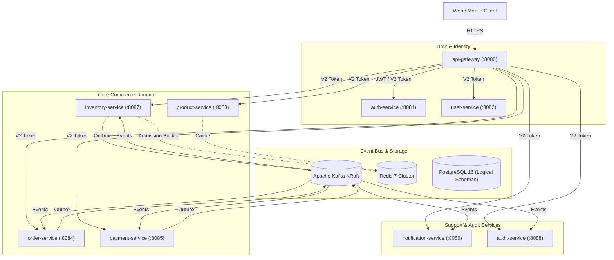

# Khandua Looms – Updated System Architecture Specification

## 1. Architectural Vision & Core Principles

The **Khandua Looms** distributed e-commerce backend platform provides a production-grade, highly available, resilient, and event-driven architecture designed for high-concurrency flash sales of one-of-a-kind handloom sarees.

### Foundational Invariants
1. **Strict Zero Overselling**: Handloom sarees are unique, high-value art pieces. Inventory available stock must never drop below zero (`available_stock >= 0`).
2. **Pessimistic & Canonical Concurrency**: Multi-SKU orders acquire locks in canonical ascending SKU ID order to prevent PostgreSQL deadlocks (`40P01`).
3. **Distributed Admission Control**: Ingress requests per SKU are controlled by an atomic Redis Lua token bucket with server-side time, backed by an in-JVM semaphore that fails closed to safeguard PostgreSQL connection pools.
4. **Idempotent Dual-Write Elimination**: State transitions and outward domain events execute inside the same ACID local database transaction via the Transactional Outbox Pattern.
5. **Idempotent At-Least-Once Delivery**: Downstream consumers enforce duplicate prevention via unique event ID tracking in dedicated deduplication tables.
6. **Isolated Watchdog Compensation**: Saga watchdog processes overdue orders in isolated transactions (`Propagation.REQUIRES_NEW`), with optimistic locking (`@Version`) ensuring that racing payment callbacks are never overridden by stale timeouts.
7. **Auditable Financial Ledger**: Gateway settlement batches are reconciled against captured payments with mathematical verification (`Gross = Fee + Tax + Net`). Discrepancies and unmatched payments are permanently audited without mutating order or inventory state.
8. **Zero-Trust Internal Network**: Microservices communicate behind an API Gateway that issues short-lived, single-use V2 assertion tokens binding HTTP method, canonical path, caller, and recipient with replay protection.

---

## 2. Microservices & Domain Module Topology



### Module Responsibilities
- **`api-gateway` (Reactive Spring Cloud Gateway)**: Ingress routing, rate limiting, JWT authentication, and V2 assertion token issuance.
- **`auth-service`**: User authentication, OAuth2, and RBAC token generation.
- **`user-service`**: Customer profile management and shipping addresses.
- **`product-service`**: Saree catalog, semantic search via `pgvector`, and category filtering.
- **`inventory-service`**: Stock management, canonical multi-SKU reservation, Redis admission control, and compensation release.
- **`order-service`**: Order lifecycle, Saga orchestration, and Saga watchdog recovery.
- **`payment-service`**: Razorpay gateway integration, refund processing, payment operation ledger, and batch settlement reconciliation.
- **`notification-service`**: Email/SMS notifications via Brevo SMTP and transactional alerts.
- **`audit-service`**: Immutable security and compliance event logging.
- **Shared Libraries**: `common-web`, `common-security`, `common-observability`, `common-messaging`, `common-test`, `event-contracts`, `api-contracts`, `schema-registry`.

---

## 3. End-to-End Distributed Transaction Flow

### 3.1 Order Checkout & Saga Orchestration

```mermaid
sequenceDiagram
    autonumber
    actor Customer
    participant Gateway as API Gateway
    participant OrderSvc as Order Service
    participant InvSvc as Inventory Service
    participant PaySvc as Payment Service
    participant Kafka as Kafka Event Bus
    participant Watchdog as Saga Watchdog

    Customer->>Gateway: POST /api/orders (Checkout Request + Idempotency-Key)
    Gateway->>OrderSvc: Forward with V2 Internal Assertion Token
    OrderSvc->>OrderSvc: Verify idempotency; Persist Order (PENDING) + OutboxEvent in DB
    OrderSvc-->>Customer: 201 Created (Order ID)

    OrderSvc->>Kafka: Outbox Publisher: orders.order-created
    Kafka->>InvSvc: Consume orders.order-created
    InvSvc->>InvSvc: SkuAdmissionControl (Redis Lua Token Bucket + JVM Semaphore)
    InvSvc->>InvSvc: Sort SKUs ascending; SELECT FOR UPDATE; Reserve Stock
    InvSvc->>Kafka: Outbox Publisher: inventory.reserved

    Kafka->>OrderSvc: Consume inventory.reserved
    OrderSvc->>OrderSvc: Transition Order -> PAYMENT_PENDING; Deadline = now + 15m

    Customer->>PaySvc: Complete Payment (Razorpay Checkout)
    PaySvc->>PaySvc: Capture Payment; Record in payment_operation_ledger; Persist Outbox
    PaySvc->>Kafka: Outbox Publisher: payment-completed

    Kafka->>OrderSvc: Consume payment-completed
    OrderSvc->>OrderSvc: Transition Order -> CONFIRMED; Mark Saga SUCCEEDED
    OrderSvc->>Kafka: Outbox Publisher: orders.order-confirmed

    Note over Watchdog,OrderSvc: Failure Scenario: Customer abandons checkout
    Watchdog->>OrderSvc: Periodic sweep detects deadline expired
    OrderSvc->>OrderSvc: Check order status; If still PAYMENT_PENDING, cancel & emit compensation
    OrderSvc->>Kafka: Outbox Publisher: inventory.release-reservation
    Kafka->>InvSvc: Consume inventory.release-reservation
    InvSvc->>InvSvc: Restore available_stock; decrement reserved_stock
```

---

## 4. Concurrency, Deadlock & Admission Safeguards

### 4.1 Canonical Multi-SKU Lock Ordering
When an order contains multiple items (e.g., SKUs `[102, 101, 105]`), concurrent orders containing overlapping subsets in different sequences could induce PostgreSQL deadlocks (`40P01`).
- **Enforcement**: In `InventoryService.processOrderReservation`, ordered items are sorted strictly in ascending order by `productId`:
  ```java
  List<OrderItemEvent> sortedItems = items.stream()
          .sorted(Comparator.comparing(OrderItemEvent::productId))
          .toList();
  ```
- **Bounded Retry**: If a lock wait timeout or deadlock occurs under extreme concurrency, the transaction catches `PessimisticLockingFailureException` and retries up to 3 times with exponential backoff and randomized jitter (50ms–200ms).

### 4.2 Distributed Token Bucket Admission Control
To shield PostgreSQL row locks and HikariCP connection pools during flash sales (10,000 req/s):
- **Redis Token Bucket**: A Redis Lua script (`inventory:admission:{sku}`) manages admission with Redis server-side time (`redis.call('TIME')`), preventing clock skew across pods.
- **Fast Fail & Graceful Fallback**: If Redis latency exceeds 100ms or Redis is unavailable, the admission control gracefully falls back to a bounded local JVM semaphore without bypassing database integrity checks.

---

## 5. Security & Zero-Trust Architecture

### 5.1 V2 Cryptographic Internal Assertion Tokens
All inter-service HTTP requests routed through `api-gateway` or between microservices require an `X-Internal-Assertion` header.
- **Payload Signature**:
  $$\text{HMAC-SHA256}(K, \text{method} \parallel \text{canonicalPath} \parallel \text{caller} \parallel \text{recipient} \parallel \text{timestamp} \parallel \text{nonce})$$
- **Nonce Replay Prevention**: A thread-safe, sliding-window cache tracks consumed nonces with a 60-second TTL. Duplicate nonces within the window trigger an immediate `401 Unauthorized` security alert.
- **Dual-Key Rotation**: The security filter checks the signature against the primary secret, and if invalid, falls back to the secondary secret. This enables seamless key rotation in production without service downtime.

---

## 6. Financial Reconciliation & Settlement Ledger

The `payment-service` incorporates a specialized financial reconciliation engine:
- **Settlement Ledger (`payment_settlement_ledger`)**: Records gateway settlement IDs, UTRs, gross amounts, gateway fees, GST deductions, net amounts, and settlement status (`SETTLED`, `DISCREPANCY`, `UNMATCHED`).
- **Discrepancy Detection**: Validates that $\text{Gross} - \text{Fee} - \text{Tax} = \text{Net}$. Any arithmetic discrepancy or difference between the captured payment and settlement gross is recorded in the ledger and alerts financial operations via Micrometer counters.
- **Isolation Invariant**: Settlement discrepancies never modify the business order state or inventory reservations directly.

---

## 7. Storage & High-Churn Performance Tuning

### 7.1 PostgreSQL Logical Schema Isolation
Each microservice owns a dedicated logical schema within the `khandualoom_db` PostgreSQL cluster:
- `auth_schema`, `user_schema`, `product_schema`, `inventory_schema`, `order_schema`, `payment_schema`, `notification_schema`, `audit_schema`.
- **Zero Cross-Schema SQL Joins**: Communication across service boundaries occurs exclusively via REST APIs and Kafka events.

### 7.2 MVCC Autovacuum Tuning
High-churn tables (`outbox_events`, `stock_reservations`, `processed_events`) undergo aggressive row modifications. To prevent PostgreSQL dead-tuple bloat and index degradation, table-level storage parameters are enforced via Flyway:
```sql
ALTER TABLE outbox_events SET (
    autovacuum_vacuum_scale_factor = 0.05,
    autovacuum_vacuum_cost_limit = 1000
);
```

### 7.3 Automated Outbox Retention Cleanup
Outbox publishers run a daily scheduled background task purging `PUBLISHED` events older than 7 days, keeping outbox tables lean and bounded.

---

## 8. High Availability & Operational Resilience

### 8.1 Kubernetes Pod Disruption Budgets (PDB)
All critical services have PDB configurations enforcing `minAvailable: 1`:
- Prevents node maintenance, drain operations, and cluster upgrades from causing service outages.

### 8.2 Graceful Shutdown & In-Flight Request Draining
Microservices are configured with Spring Boot graceful shutdown:
```yaml
server:
  shutdown: graceful

spring:
  lifecycle:
    timeout-per-shutdown-phase: 30s
```
Upon receiving `SIGTERM`, pods stop accepting new traffic, complete active database transactions, commit in-flight Kafka offsets, and terminate cleanly within 30 seconds.
