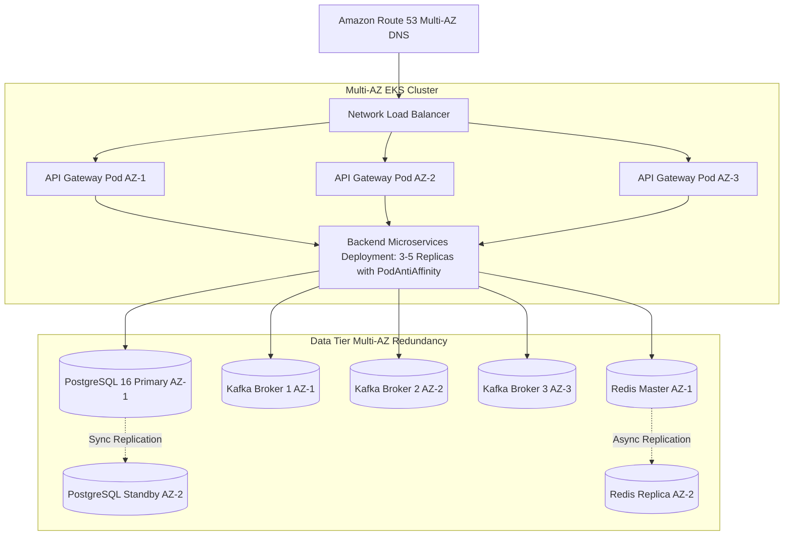

# High Availability & Disaster Recovery Architecture

## Availability Architecture (99.99% SLA Target)

To guarantee 99.99% availability (maximum allowable unplanned downtime of 52.6 minutes/year), Khandua Looms employs a multi-tier redundancy topology across three Availability Zones (AZs) in the primary AWS region (`ap-south-1`).



---

## 1. Disaster Recovery (DR) Tiers & Objectives

| Tier | Component | DR Mechanism | Target RTO | Target RPO |
| :--- | :--- | :--- | :--- | :--- |
| **Tier 1 (Critical)** | `order_schema`, `payment_schema`, `inventory_schema` | Multi-AZ Sync Streaming Replication + WAL-G continuous S3 archiving | **< 60 seconds** | **< 5 seconds** |
| **Tier 2 (Essential)** | Kafka KRaft Clusters | Minimum in-sync replicas (`min.insync.replicas=2`, `replication.factor=3`) | **< 30 seconds** | **0 data loss** (`acks=all`) |
| **Tier 3 (Supporting)** | `product_schema`, `user_schema`, `auth_schema` | Hourly snapshot + S3 cross-region replication | **< 15 minutes** | **< 1 hour** |
| **Tier 4 (Ephemeral)** | Redis Distributed Cache | Ephemeral cache; graceful DB fallback if cluster is cold | **< 5 minutes** | **N/A** (Rebuilt from DB) |

---

## 2. Backup & Recovery Runbook

### Continuous Database Backups (WAL-G to Amazon S3)
```bash
# Verify latest backup archive in S3
wal-g backup-list

# Point-in-Time Recovery (PITR) Execution
wal-g backup-fetch /var/lib/postgresql/data LATEST
cat << EOF > /var/lib/postgresql/data/recovery.signal
restore_command = 'wal-g wal-fetch "%f" "%p"'
recovery_target_time = '2026-11-05 23:45:00 UTC'
EOF
pg_ctl start -D /var/lib/postgresql/data
```

---

## 3. Chaos Engineering & Failure Scenarios

### Scenario 1: Redis Cluster Complete Failure
- **Behavior**: Microservices detect Redis connection timeout via Lettuce circuit breaker.
- **Resilience**: Applications automatically bypass cache and read directly from PostgreSQL.
- **Zero Inconsistency**: Financial and inventory transactions **never depend on Redis for correctness**. Stock reservations and payment ledgers reside exclusively in PostgreSQL with ACID guarantees.

### Scenario 2: Kafka Broker Failure During High Traffic
- **Behavior**: Producer has `acks=all` and `retries=Integer.MAX_VALUE`.
- **Resilience**: Outbox records remain safely stored in `outbox_events` table with status `FAILED` or `PENDING`. When the Kafka broker recovers or leader re-election finishes, the scheduled outbox publisher seamlessly drains the backlog without data loss.

### Scenario 3: Complete Availability Zone Loss
- **Behavior**: EKS autoscaler detects lost nodes in AZ-1; schedules replacement pods across surviving AZ-2 and AZ-3.
- **Resilience**: PodAntiAffinity ensures no single microservice has all replicas in a single zone. Traffic is rerouted in under 5 seconds.
