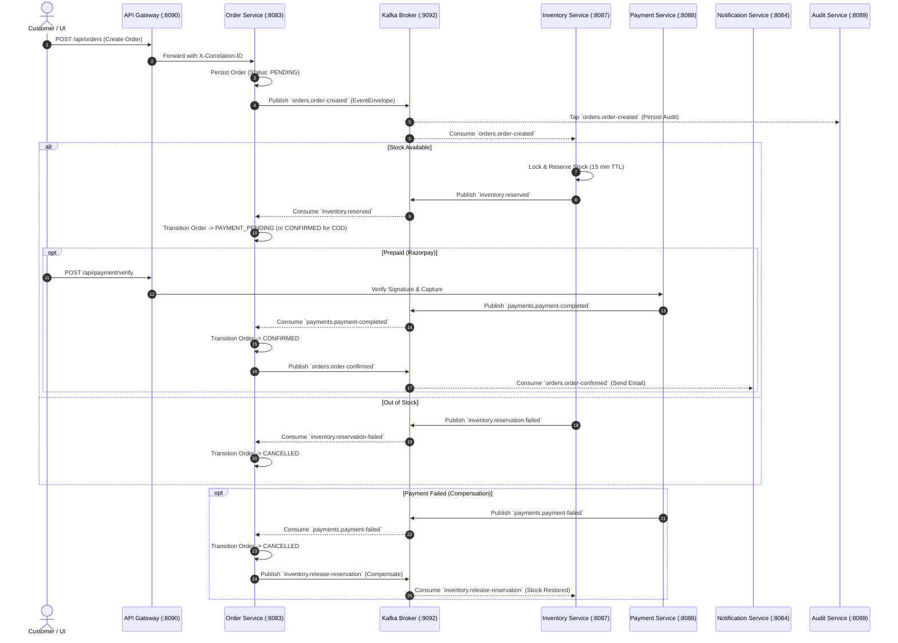

# Khandua Looms — Target Microservices Architecture

## 1. Executive Summary & Architectural Vision

The **Khandua Looms** distributed commerce platform has been refactored and upgraded from a legacy monolithic/loosely coupled layout into a production-grade, enterprise microservices architecture governed by:

- **Domain-Driven Design (DDD)**: Explicit bounded contexts, aggregate roots, entities, value objects, domain events, and domain invariants.
- **Hexagonal Architecture (Ports and Adapters / Clean Architecture)**: Inversion of control ensuring core domain logic has zero external dependencies on Spring Boot, Hibernate, Kafka, or HTTP protocols.
- **Event-Driven Architecture (EDA)**: KRaft Kafka event streaming, event choreography, Saga orchestration for distributed multi-step transactions, and Transactional Outbox pattern guarantees.
- **Dedicated Database Schema Isolation**: Zero cross-schema SQL joins; exclusive ownership of isolated PostgreSQL 16 schemas per microservice bounded context.
- **High-Throughput Reactive Edge**: Spring Cloud Gateway routing requests dynamically with non-blocking rate limiting, correlation tracking, and JWT token relay.
- **Unified Observability**: W3C Trace Context propagation, Micrometer Prometheus metrics, and OpenTelemetry OTLP tracing into Grafana Tempo.

---

## 2. High-Level System Architecture

```mermaid
flowchart TD
    subgraph ClientLayer ["Client & Edge Ingress"]
        WebClient["React Luxury Storefront (:5174 / :3000)"]
        AdminClient["Admin Web Console"]
    end

    subgraph Gateway ["Edge Routing & Security"]
        APIGW["Spring Cloud API Gateway (:8090 / :8080)<br/>• Non-blocking Netty<br/>• Correlation ID Injection<br/>• Global CORS & Rate Limiting"]
    end

    subgraph Microservices ["Dedicated Microservices (Hexagonal Architecture)"]
        AUTH["Auth Service (:8081)<br/>Identity Bounded Context<br/>JWT & Refresh Token Rotation"]
        USER["User Service (:8086)<br/>User Bounded Context<br/>Profiles & Addresses"]
        PROD["Product Service (:8082)<br/>Catalog Bounded Context<br/>Vector Embeddings & Redis"]
        INV["Inventory Service (:8087)<br/>Stock Bounded Context<br/>Pessimistic Lock & Auto-Release"]
        ORD["Order Service (:8083)<br/>Order Bounded Context<br/>Saga Orchestrator"]
        PAY["Payment Service (:8088)<br/>Payment Bounded Context<br/>Razorpay Gateway & Webhooks"]
        NOTIF["Notification Service (:8084)<br/>Notification Bounded Context<br/>Brevo SMTP & Async Worker"]
        AUDIT["Audit Service (:8089)<br/>Audit Bounded Context<br/>Immutable Global Audit Trail"]
    end

    subgraph Messaging ["Event Streaming Fabric"]
        KAFKA["Apache Kafka (KRaft Mode - :9092)<br/>• orders.order-created<br/>• inventory.reserved<br/>• inventory.reservation-failed<br/>• payments.payment-completed<br/>• payments.payment-failed<br/>• orders.order-confirmed<br/>• inventory.release-reservation"]
    end

    subgraph DataTier ["Data & Cache Tier (Isolated Schemas)"]
        PG[("PostgreSQL 16 + pgvector<br/>• auth_schema<br/>• user_schema<br/>• product_schema<br/>• inventory_schema<br/>• order_schema<br/>• payment_schema<br/>• notification_schema<br/>• audit_schema")]
        REDIS[("Redis 7 Cache (:6379)<br/>• Product & Category Cache-Aside<br/>• Active Session Store")]
    end

    subgraph ObservabilityTier ["Observability & Telemetry"]
        PROM["Prometheus (:9090)<br/>Scraping /actuator/prometheus"]
        TEMPO["Grafana Tempo (:3200 / :4318)<br/>OTLP Distributed Traces"]
        GRAF["Grafana (:3001)<br/>Unified Telemetry Dashboards"]
    end

    WebClient -->|HTTP/REST| APIGW
    AdminClient -->|HTTP/REST| APIGW

    APIGW -->|/api/auth/**| AUTH
    APIGW -->|/api/users/**| USER
    APIGW -->|/api/products/**| PROD
    APIGW -->|/api/inventory/**| INV
    APIGW -->|/api/orders/**| ORD
    APIGW -->|/api/payments/**| PAY
    APIGW -->|/api/notifications/**| NOTIF
    APIGW -->|/api/audit/**| AUDIT

    AUTH -->|Schema: auth_schema| PG
    USER -->|Schema: user_schema| PG
    PROD -->|Schema: product_schema| PG
    PROD --> REDIS
    INV -->|Schema: inventory_schema| PG
    ORD -->|Schema: order_schema| PG
    PAY -->|Schema: payment_schema| PG
    NOTIF -->|Schema: notification_schema| PG
    AUDIT -->|Schema: audit_schema| PG

    ORD -.->|Publish: order-created| KAFKA
    KAFKA -.->|Consume: order-created| INV
    INV -.->|Publish: inventory.reserved / failed| KAFKA
    KAFKA -.->|Consume: inventory.reserved| ORD
    PAY -.->|Publish: payment-completed / failed| KAFKA
    KAFKA -.->|Consume: payment events| ORD
    ORD -.->|Compensate: release-reservation| KAFKA
    KAFKA -.->|Global Tap: all events| AUDIT
    KAFKA -.->|Consume: order-confirmed| NOTIF

    AUTH & USER & PROD & INV & ORD & PAY & NOTIF & AUDIT & APIGW -.->|OTLP Traces| TEMPO
    AUTH & USER & PROD & INV & ORD & PAY & NOTIF & AUDIT & APIGW -.->|Prometheus Metrics| PROM
    PROM --> GRAF
    TEMPO --> GRAF
```



---

## 3. Hexagonal Architecture Standard

Each microservice adheres to the Ports and Adapters pattern with rigorous boundary isolation:

```
service-name/
└── src/main/java/com/khandualoom/microservice/{service}/
    ├── domain/                   <-- PURE POJOs: Zero Spring / Zero ORM / Zero Kafka
    │   ├── model/                <-- Entities & Aggregate Roots
    │   ├── valueobject/          <-- Immutable Value Objects (Money, Email, Sku)
    │   ├── event/                <-- Pure Domain Events
    │   ├── exception/            <-- Domain Invariant Violations
    │   ├── repository/           <-- Output Port Interfaces
    │   └── service/              <-- Pure Domain Services
    │
    ├── application/              <-- ORCHESTRATION LAYER: Use Cases
    │   ├── port/
    │   │   ├── in/               <-- Input Port Interfaces (Commands / Queries)
    │   │   └── out/              <-- Output Port Interfaces (Gateway / Client Ports)
    │   ├── usecase/              <-- Implementation of Input Ports
    │   ├── command/              <-- Write Command Objects
    │   ├── query/                <-- Read Query Objects
    │   └── mapper/               <-- Domain <-> DTO Mappers
    │
    ├── infrastructure/           <-- ADAPTERS: Spring Data, Kafka, Redis, HTTP Clients
    │   ├── persistence/
    │   │   ├── entity/           <-- JPA @Entity classes (e.g. OrderJpaEntity)
    │   │   ├── repository/       <-- Spring Data JpaRepository
    │   │   └── adapter/          <-- Implementation of Domain Repository Ports
    │   ├── messaging/
    │   │   ├── producer/         <-- KafkaTemplate event publishers
    │   │   └── consumer/         <-- @KafkaListener event handlers
    │   ├── client/               <-- External clients (Razorpay, Brevo, OpenTelemetry)
    │   └── configuration/        <-- Spring @Configuration beans
    │
    └── presentation/             <-- DRIVING ADAPTERS: HTTP Controllers
        ├── controller/           <-- Thin Spring REST Controllers
        ├── request/              <-- Jakarta-validated Request Payloads
        ├── response/             <-- RFC 7807 & ApiResponse Envelopes
        └── exception/            <-- @RestControllerAdvice Exception Handlers
```

---

## 4. Bounded Context Map & Ubiquitous Language

| Bounded Context | Microservice | Responsibilities | Core Entities / Aggregates | Ubiquitous Terms |
| :--- | :--- | :--- | :--- | :--- |
| **Identity & Access** | `auth-service` | User authentication, session hashing, refresh token rotation, OAuth2 SSO, RBAC | `UserCredential`, `ActiveSession`, `Role` | Principal, Subject, Token Hash, Compromise Invalidation |
| **User Profile** | `user-service` | Customer personal profile, shipping/billing addresses, customer status | `UserProfile`, `Address` | Customer, Address Book, Default Shipping Address |
| **Product Catalog** | `product-service` | Saree catalog, fabric attributes, weave types, pricing, pgvector semantic search | `Product`, `Category`, `Embedding` | Saree, Weave, Border, Pallu, Silk Mark, Vector Cosine |
| **Inventory** | `inventory-service` | Stock levels, pessimistic locking, 15-minute stock reservations, auto-expiration | `InventoryItem`, `StockReservation` | Available Stock, Reserved Stock, Expiration Sweep, Stock Release |
| **Order Management** | `order-service` | Order lifecycle, checkout validation, Saga state machine orchestrator | `Order`, `OrderItem`, `SagaState` | Checkout, Order State, Reservation Pending, Payment Pending |
| **Payment** | `payment-service` | Razorpay payment orders, webhook signatures, idempotency key validation | `Payment`, `PaymentTransaction` | Capture, Signature Verification, Idempotency Key, Refund |
| **Notification** | `notification-service` | Async transactional emails (Brevo SMTP), order confirmation dispatch | `NotificationLog`, `EmailTemplate` | Transactional Email, Dispatch Queue, Template Engine |
| **Audit** | `audit-service` | Immutable event sourcing audit trail across domain events | `AuditEvent` | Audit Trail, Action Type, Actor, Payload Delta |

---

## 5. Distributed Transaction Management: Orchestrated Saga

### Order Checkout & Payment Saga Workflow



---

## 6. Multi-Module Maven Hierarchy

```
microservice-parent/ (Aggregator POM)
├── pom.xml
├── common-library/
│   ├── pom.xml (Aggregator)
│   ├── common-web/             (RFC 7807, Correlation Filter, Global Exception Handlers)
│   ├── common-security/        (JWT Validation, SHA-256 Hashing, Security Constants)
│   ├── common-observability/   (Logstash JSON Logging, Prometheus, OTLP Traces)
│   ├── common-messaging/       (AbstractOutboxEntity, OutboxStatus, ProcessedEvent)
│   └── common-test/            (Testcontainers for PostgreSQL 16 & Kafka KRaft)
├── contracts/
│   ├── pom.xml (Aggregator)
│   ├── event-contracts/        (EventEnvelope, Domain Integration Event Records)
│   ├── api-contracts/          (Cross-service Shared DTOs)
│   └── schema-registry/        (Event Schema Registry & Compatibility)
├── api-gateway/                (Port 8080/8090 - Spring Cloud Gateway Netty)
├── auth-service/               (Port 8081 - Identity Bounded Context)
├── user-service/               (Port 8086 - User Bounded Context)
├── product-service/            (Port 8082 - Catalog & Vector Search Context)
├── inventory-service/          (Port 8087 - Stock Reservation Context)
├── order-service/              (Port 8083 - Order & Saga Coordinator Context)
├── payment-service/            (Port 8088 - Razorpay & Payment Context)
├── notification-service/       (Port 8084 - Brevo Transactional Email Context)
└── audit-service/              (Port 8089 - Global Audit Trail Context)
```
