# Khandua Looms — Database Schema & Partitioning Design

## 1. Multi-Schema Partitioning in PostgreSQL 16

The backend utilizes PostgreSQL 16 with the `pgvector` and `uuid-ossp` extensions. Rather than sharing a monolithic default `public` schema, every bounded context possesses an isolated schema with explicit ownership and zero foreign-key relationships spanning schemas.

```mermaid
erDiagram
    auth_schema_users ||--o{ auth_schema_active_sessions : "has"
    auth_schema_users ||--o{ auth_schema_user_roles : "has"
    user_schema_user_profiles ||--o{ user_schema_addresses : "maintains"
    product_schema_products ||--o{ product_schema_product_images : "features"
    product_schema_products }o--|| product_schema_categories : "belongs_to"
    inventory_schema_inventory_items ||--o{ inventory_schema_stock_reservations : "reserves"
    order_schema_orders ||--o{ order_schema_order_items : "contains"
    payment_schema_payments ||--o{ payment_schema_payment_transactions : "records"
    notification_schema_notifications }o--|| notification_schema_templates : "uses"
    audit_schema_audit_events
```



---

## 2. Schema Breakdown & Ownership

| Schema Name | Service Owner | Primary Tables | Primary Responsibilities |
| :--- | :--- | :--- | :--- |
| `auth_schema` | `auth-service` | `users`, `roles`, `user_roles`, `active_sessions`, `refresh_tokens` | Authentication credentials, SHA-256 session token hashes, revocation |
| `user_schema` | `user-service` | `user_profiles`, `addresses`, `user_preferences` | Customer personal information, shipping/billing addresses |
| `product_schema` | `product-service` | `products`, `categories`, `product_images`, `product_embeddings` | Catalog data, weave attributes, 1536-dim vector embeddings |
| `inventory_schema` | `inventory-service` | `inventory_items`, `stock_reservations` | Real-time stock counts, pessimistic reservation locks, TTL sweeps |
| `order_schema` | `order-service` | `orders`, `order_items`, `saga_instances` | Order records, state machine stages, checkout snapshots |
| `payment_schema` | `payment-service` | `payments`, `payment_transactions`, `idempotency_keys` | Razorpay order IDs, signatures, amounts, refund states |
| `notification_schema` | `notification-service` | `notification_logs`, `email_templates` | Brevo SMTP delivery logs, customer emails |
| `audit_schema` | `audit-service` | `audit_events` | Immutable platform-wide event audit trail |

---

## 3. High-Performance Indexing & pgvector

1. **pgvector Indexing (Product Catalog)**:
   - Column `embedding` is defined as `vector(1536)`.
   - Indexed via HNSW (Hierarchical Navigable Small World) with Cosine Distance:
     ```sql
     CREATE INDEX idx_products_vector ON product_schema.products 
     USING hnsw (embedding vector_cosine_ops) WITH (m = 16, ef_construction = 64);
     ```
2. **Pessimistic Locking & Reservation Indexes**:
   - `inventory_schema.stock_reservations` indexes `(status, expires_at)` to enable efficient $O(\log n)$ expiration sweeps by the scheduled background cleaner.
3. **Audit Event Query Optimization**:
   - `audit_schema.audit_events` indexes `(aggregate_type, aggregate_id)` and `created_at DESC` for sub-millisecond timeline retrieval.
